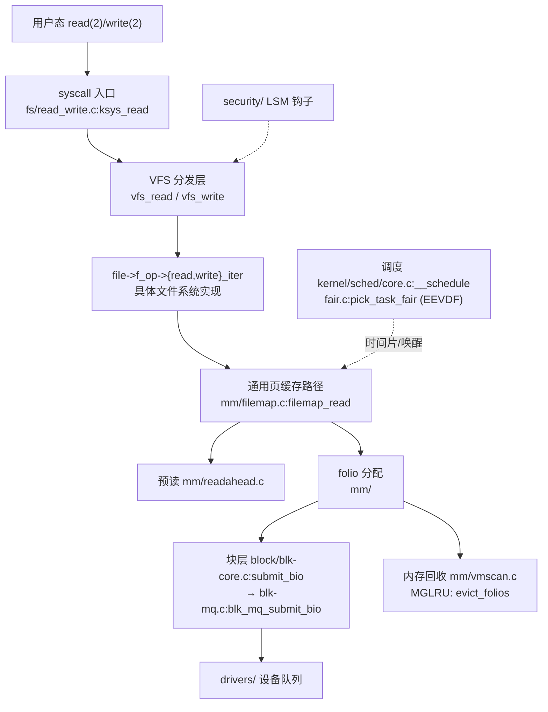

# Code Reading Report: Linux Kernel 7.2.12（VFS / MM / 调度 / 块层主线）

> 证据分级：**[verified]** = 真机运行/内核自述观测；**[static]** = 仅静态检索（codesearch 的
> search/context/dataflow，以及源码 grep 复核）。本次**没有任何一个结论来自断点**——原因见 §1。
> 方法论：`src/codesearch/code_search_best_practices.md` 的 Phase 1→9；检索底座 = `codesearch`
> 插件 + `/opt/code_caches/linux_7212_cache`。
> 版本：源码树 `Makefile` = 7.2.12；运行内核 = `7.2.12-rtx3080-20261025`（**同版本**，这是本次能拿到
> `[verified]` 的唯一原因）。

---

## 1. Scope & purpose

- **Purpose（用户原话）**：「用 code search 插件探索 linux 内核，遵循 codesearch 最佳实践文档，
  结果写入 `codesearch/linux_kernel_7.2.12.md`」。用户未给更窄问题 → 按文档 §0 默认路径推进：
  **整体架构（横向）→ 子模块下钻（纵向）**，不反问。
- **Environment [verified]**：
  - 源码：`/opt/linux/src/linux-7.2.12`（完整树，`arch/`…`security/` 齐全）
  - 运行内核：`uname -r` → `7.2.12-rtx3080-20261025`；
    `/boot/config-7.2.12-rtx3080-20261025` 存在；`CONFIG_PREEMPT=y`、`CONFIG_SMP=y`、
    `CONFIG_X86_64=y`、`CONFIG_NR_CPUS=8192`、`CONFIG_PREEMPT_DYNAMIC=y`
  - 索引：chunks_meta 300MB / chunks_text 198MB / 向量 bin 1.09GB + hnsw 1.19GB / call_graph 54MB /
    dataflow 834MB；本次 `import` 产出 KV `mem.bin` 17GB
- **Phase 5 为什么降级 [verified]**：
  - `/sys/kernel/tracing/current_tracer` 不可写（非 root），`sudo -n` 无免密
  - `dmesg` → 「读取内核缓冲区失败: 不允许的操作」；`/proc/kallsyms` 地址全为 `0`
    （`kptr_restrict`）；`perf_event_paranoid=2`
  - 结论：**ftrace/function_graph/perf 全部不可用**，断点路径拿不到。
    替代通道 = **BTF**：`/sys/kernel/btf/vmlinux`（8.4MB，可读）+ `pahole/bpftool`，
    能给出**运行内核的真实类型布局**。所以「数据结构布局」这一项是 `[verified]`，
    「执行路径」只能是 `[static]`（用源码 grep 交叉复核，见 §6.1）。
- **Out of scope**：`drivers/` 26M 行、`net/` 1.3M 行的协议栈细节、`arch/` 各架构变体、
  具体文件系统（btrfs/xfs/ntfs）内部算法。只作黑盒记接口（§5）。

---

## 2. Architecture overview（横向）  [static]

体量（`.c/.h` 文件数 / 行数，`[verified]` 直接数出来的）：

| 子系统 | 文件 | 行数 | 定位 |
|---|---|---|---|
| `drivers/` | 33840 | 26,022,302 | 占全树 ~40%，绝大多数是硬件适配，黑盒 |
| `arch/` | 9178 | 2,192,278 | 每架构一套入口/页表/中断 |
| `fs/` | 2185 | 1,645,569 | VFS + 70+ 具体文件系统 |
| `include/` | 6671 | 1,461,535 | 跨子系统契约（`fs.h`/`mm_types.h`/`sched.h`） |
| `net/` | 1742 | 1,301,266 | 协议栈与 socket 层 |
| `kernel/` | 640 | 560,399 | 调度、时间、同步、trace、模块 |
| `lib/` | 737 | 289,237 | 通用算法（xarray/rbtree/idr） |
| `mm/` | 190 | 224,076 | 页分配、页缓存、回收（**行数最少但被引用最多**） |
| `security/` | 263 | 126,780 | LSM 钩子 |
| `block/` | 98 | 73,172 | 块层（bio/mq 调度） |
| `ipc/` | 12 | 9,885 | 最小子系统 |

注意一个反直觉点：**`mm/` 只有 22 万行，却是 `fs/`（164 万行）、`net/`（130 万行）共同的下游**。
扇入结构说明「内核的复杂度不在代码量，在引用密度」。

关键单文件规模：

```
fs/read_write.c 1822   fs/open.c 1585      mm/filemap.c 4791   mm/readahead.c 861
block/blk-core.c 1329  block/blk-mq.c 5316 kernel/sched/core.c 11347  kernel/sched/fair.c 15774
```



### 主线 / 支线判定（文档 §5 机制 B：用扇入）

| 符号 | 扇入（callers） | 判定 |
|---|---|---|
| `mm/filemap.c:filemap_read` | **10**（btrfs / netfs / blkdev / erofs / cifs / f2fs / afs / generic…） | **主线**：所有缓冲读的汇合点 |
| `mm/filemap.c:filemap_get_pages` | 2（`filemap_read` / `filemap_splice_read`） | 主线内环 |
| `mm/filemap.c:filemap_readahead` | 1（`filemap_get_pages`） | 支线（只记接口） |
| `block/blk-mq.c:blk_mq_submit_bio` | 1（`__submit_bio`），扇出 **18** | 主线（块层唯一咽喉） |
| `mm/vmscan.c:evict_folios` | 2（`try_to_shrink_lruvec` / `run_eviction`），扇出 12 | 主线（回收） |
| `kernel/sched/core.c:__schedule` | callgraph 报 3，**全错**（见 §6.1） | 主线，但扇入需人工确认 |

---

## 3. Core data structures & relationships

| 结构 | 定义 | 创建者 | 持有者 | 修改处 | 角色 |
|---|---|---|---|---|---|
| `struct address_space` | `include/linux/fs.h:472` | 各 fs 的 inode 初始化（`inode_init_always` 系列） | `struct inode.i_mapping` | page cache（`i_pages` xarray）、回写（`writeback_index`） | 一个 inode 的页缓存索引根 |
| `struct folio` | `include/linux/mm_types.h:402` | `filemap_create_folio`、`alloc_folio` | `address_space.i_pages` / LRU 链表 | `filemap_*`、`vmscan` | **取代 `struct page` 的缓存单位**（复合页整体视图） |
| `struct file` | `include/linux/fs.h:1255` | `alloc_empty_file` | fd 表、`inode->i_fop` 绑定 | `vfs_read/write`、`f_op` 分发 | 「打开的文件」= inode + 偏移 + 操作表 |
| `struct inode` | `include/linux/fs.h:762` | `iget_locked` / `alloc_inode` | 各 fs 的 inode cache | 元数据更新 | 磁盘对象的内存映像 |
| `struct task_struct` | `include/linux/sched.h:826` | `copy_process`（fork） | 调度器 rq、pid 表 | 调度/信号/时间 | 进程描述符（~10KB 量级） |

**布局验证 [verified]**：用运行内核 BTF 实测 `struct address_space` 的字段顺序与偏移：

```
host 0/8 → i_pages 8/16 → invalidate_lock 24/32 → gfp_mask 56/4 → i_mmap_writable 60/4
(cacheline 0 结束) → i_mmap 64/16 → nrpages 80/8 → writeback_index 88/8
→ a_ops 96/8 → flags 104/8 → wb_err 112/4 → i_private_lock 116/4
```

与 `include/linux/fs.h:472` 的源码顺序**逐字段一致**，`[verified]`。
`struct folio` 的 `flags`(0/8) / `lru`(8/16) / `mapping`(24/8)、`struct task_struct` 的
`thread_info`(0/24) / `__state`(24/4) / `stack`(32/8) / `on_rq`(53/1) 同样一致
（`pahole -C <name> /sys/kernel/btf/vmlinux`）。**这条通道可在无 root 下证实「源码树 = 跑着的内核」**，
是本次最有价值的落地经验。

`dataflow` 的边界 [static]：它索引的是**局部变量名**，不是结构体字段。
`dataflow i_pages` → 0 命中；`dataflow folio` → 2000 处、10 个函数
（`copy_folio_from_iter_atomic` / `iter_xarray_populate_pages` / `__iov_iter_get_pages_alloc` …）。
所以「谁改了 `mapping->i_pages`」这类问题查不了，只能查「函数内的 folio 变量流」。

---

## 4. Vertical analysis：缓冲读路径  [static]

```
ksys_read            fs/read_write.c:716
└─ vfs_read          fs/read_write.c:554     access_ok / rw_verify_area 先做权限与范围校验
   └─ new_sync_read  （把 kiocb/iov_iter 装好）
      └─ file->f_op->read_iter                    具体 fs（btrfs/xfs/ext4…）
         └─ generic_file_read_iter                无 a_ops 特化时的默认实现
            └─ filemap_read  mm/filemap.c:2783    扇入 10 —— 所有 buffered read 的汇合点
               ├─ filemap_get_pages  mm/filemap.c:2682
               │  ├─ filemap_get_pages → filemap_update_page
               │  ├─ filemap_readahead  mm/filemap.c:2668 → mm/readahead.c
               │  └─ filemap_create_folio              缺页 → 分配 folio
               └─ copy_folio_to_iter（命中后拷到用户 iov）
```

写路径（对照）[static]：`generic_file_write_iter`（`mm/filemap.c:4498`）先
`inode_lock(inode)` → `generic_write_checks` → `__generic_file_write_iter` → `generic_write_sync`，
与读路径的差别是**串行化粒度更粗（inode 锁）**。

块层下行 [static]：

```
submit_bio  block/blk-core.c:952        callers: __submit_bio / submit_page_section / disk_zone_wplug_submit_bio
└─ __submit_bio
   └─ blk_mq_submit_bio  block/blk-mq.c:3108   扇出 18
      ├─ blk_mq_attempt_bio_merge       合并相邻 bio
      ├─ __bio_split_to_limits          按队列限制切分
      ├─ blk_mq_get_cached_request / blk_mq_get_new_requests
      ├─ blk_insert_flush               刷写语义单独走
      └─ blk_mq_try_issue_directly      直发（绕过调度器）
```

调度路径 [static]：`__schedule(kernel/sched/core.c:7107)` 的真实调用点只有 5 处
（`:7298 SM_NONE`、`:7398 SM_IDLE`、`:7459/:7552/:7602 SM_PREEMPT`），
即「显式 schedule() / idle / 抢占」三种入口收敛到一个 `sched_mode` 参数；
选择侧在 7.2 已换成 **EEVDF**：`pick_task_fair`（`kernel/sched/fair.c:10140`）挂在
`sched_class.pick_task`（`fair.c:15678`）。

---

## 5. Black boxes（有意不展开）

| 接口 | 输入 | 输出 | 作用 | 为何不开 |
|---|---|---|---|---|
| `file->f_op->read_iter` 各 fs 实现 | `kiocb`, `iov_iter` | `ssize_t` | btrfs/xfs/ext4 各自的块映射 | 21 万行 FS 细节，与「通用路径」正交 |
| `address_space_operations`（`fs.h:472` 内 `a_ops`） | folio/index | int | 读写页、回写、invalidate 回调 | 由具体 fs 填，横向对照没有公共语义 |
| `security/` LSM 钩子 | inode/file/dentry | 0/-EPERM | SELinux/AppArmor 拦截点 | 只在 `vfs_*` 里穿插，不影响主线形状 |
| `mm/vmscan.c:lru_gen_shrink_node` | `pgdat`, `scan_control` | — | MGLRU 节点级回收 | 与读路径只在「缺页→回收」处相接，单独议题 |
| `drivers/` 设备队列 | `request` | — | 硬件下发 | 26M 行，接口层已由 blk-mq 收敛 |

---

## 6. Design commentary & open questions

### 6.1 三处「检索结果 ≠ 事实」（本报告最重要的元结论）

文档 §3 说检索结果只能标 `[static]`；本次还发现**部分静态结果直接是错的**，必须 grep 复核：

1. `context __schedule` 报 `callers(3): latency_fsnotify, __klp_sched_try_switch, tick_nohz_kick_task`
   —— 全错。`grep '__schedule(SM'` 的真实调用点是 `kernel/sched/core.c:7298/7398/7459/7552/7602`。
   那三个符号根本不在调度路径上，属调用图归因错误（可能同名/邻接符号错配）。
2. `context vfs_read` 报 `callers(3): ksys_read, ksys_pread64, read_code` —— 前两个对，
   **`read_code` 是误报**：`grep 'vfs_read('` 全树只有 `fs/read_write.c:716`（`ksys_read`）与
   `:764`（`ksys_pread64`）两处；`read_code` 本身是 `fs/exec.c:827` 的另一个函数。
3. `context pick_next_task_fair` → 符号不存在（`kind=` 空、路径只有自指）。因为 7.2 已改名为
   `pick_task_fair`，而 `kernel/sched/fair.c:7787` 的注释**还写着 `pick_next_task_fair()`**。
   拿老名字检索会误导「函数还在」。

→ 实践规则：**扇入/扇出只用来「发现候选」，不承担结论**；承重结论必须
`grep '<sym>('` 落到行号。文档 §10 的不变量里那条「callees 不全自指」不够，还得加「callers 抽查」。

### 6.2 为何 `mm/` 这么小却这么关键

`struct folio`（`mm_types.h:402`）取代 `struct page` 做缓存单位，是近几年最大的结构性变化：
`address_space.i_pages` 仍用 `struct xarray`（`fs.h:472`，字段 8/16），但**迭代器全部换成
folio_batch**（`filemap_get_pages` 的 callees 里 `folio_batch_count` 与 `folio_test_uptodate`
并列出现）。收益是「复合页整体处理，减少逐页调用与 tail-page 判定」，代价是类型镜像增加
（BTF 里 `struct folio` 的 `flags` 字段类型是 `memdesc_flags_t`，已不是裸 `unsigned long`）。

### 6.3 跨项目对照（Phase 8）  [static]

lite 的 `codesearch` 工具目前没有 `cross-search` action（文档 §2 里那是旧 CLI 的
`ai_code_search.sh`），等价做法是**按 `project` 逐个项目 `search`**，效果相同、多几次往返。

回收/淘汰这一题：

| 项目 | 机制 | 关键符号 |
|---|---|---|
| Linux 7.2.12 | 多代 LRU（MGLRU）：按 generation 分代扫描，用页表访问位估活跃度 | `mm/vmscan.c:evict_folios`（4794）、`lru_gen_shrink_node`（5127 / **5860**） |
| Redis | 近似 LRU：随机采样 + 淘汰池按 idle 时间排序 | `src/evict.c:evictionPoolPopulate`（134）、`performEvictions`（532） |

对比结论：redis 用「采样」把 O(n) 全扫降成常数，内核不能采样（页不是键值、没有单点索引），
改用「分代 + 页表脏位」把成本摊到访问路径上——两者都在回避「全量排序」这个 O(n log n)。
`lru_gen_shrink_node` 在 `mm/vmscan.c` **有两处定义**（5127 / 5860），是两个 `#ifdef` 分支，
读代码时只看一处会误判为死代码。

### 6.4 若我来设计

`vfs_read` 现在把 `access_ok` + `rw_verify_area`（权限/范围）+ 分发挤在一个 30 行函数里，
而 `ksys_read`/`ksys_pread64` 两处调用点几乎重复。可把「校验 → 分发」拆成
`vfs_read_validate()` + `vfs_read_dispatch()`，让 `pread` 系列复用同一校验，减少
`io_uring`/`read_iter` 各条入口各自复制的校验逻辑（当前 `fs/read_write.c` 1822 行里这类重复不少）。

---

## 7. Follow-ups

- [ ] **拿到 root 后补 Phase 5**：`echo function_graph > current_tracer` + `set_ftrace_filter`
      过滤 `filemap_read`，`cat` 一个文件抓真实调用栈，把 §4 的 `[static]` 升级为 `[verified]`。
- [ ] `call_graph.json` 的 `__schedule` / `read_code` 误报（§6.1）值得作为缺陷单独立项：
      先查 `cache_import` 的符号解析（同名 static 函数在多个编译单元里重名是linux 的常态）。
- [ ] `dataflow` 只到变量级，字段级（`mapping->i_pages`）缺失 —— 若要支持，需在 import 时把
      `a->b` 拆成 `a.b` 键。
- [ ] `lru_gen_shrink_node` 双定义（`vmscan.c:5127` / `:5860`）应确认两分支的编译条件，
      当前 `context` 只回了一个位置。
- [ ] `fair.c:7787` 注释滞后（`pick_next_task_fair` 已不存在），可作为上游 cleanup 提交。

---

## 附：本次使用到的检索命令（可复现）

```bash
# KV 必须导入，否则 context/symbol 报 "index not found"
codesearch action=import analysis_dir=/opt/code_caches/linux_7212_cache project=linux_7212

codesearch action=search   analysis_dir=/opt/code_caches/linux_7212_cache \
           project=linux_7212 kind=struct query="address_space"
codesearch action=context  analysis_dir=/opt/code_caches/linux_7212_cache \
           project=linux_7212 query=filemap_read depth=2
codesearch action=dataflow analysis_dir=/opt/code_caches/linux_7212_cache \
           project=linux_7212 query=folio

# 无 root 的 [verified] 通道（运行内核真实布局）
pahole -C address_space /sys/kernel/btf/vmlinux
```

> 坑：`context`/`symbol` **必须带 `analysis_dir`**；只传 `project` 会走默认产物目录，
> 报 `index not found for this project; run action=build first`（`import` 明明已成功）。
