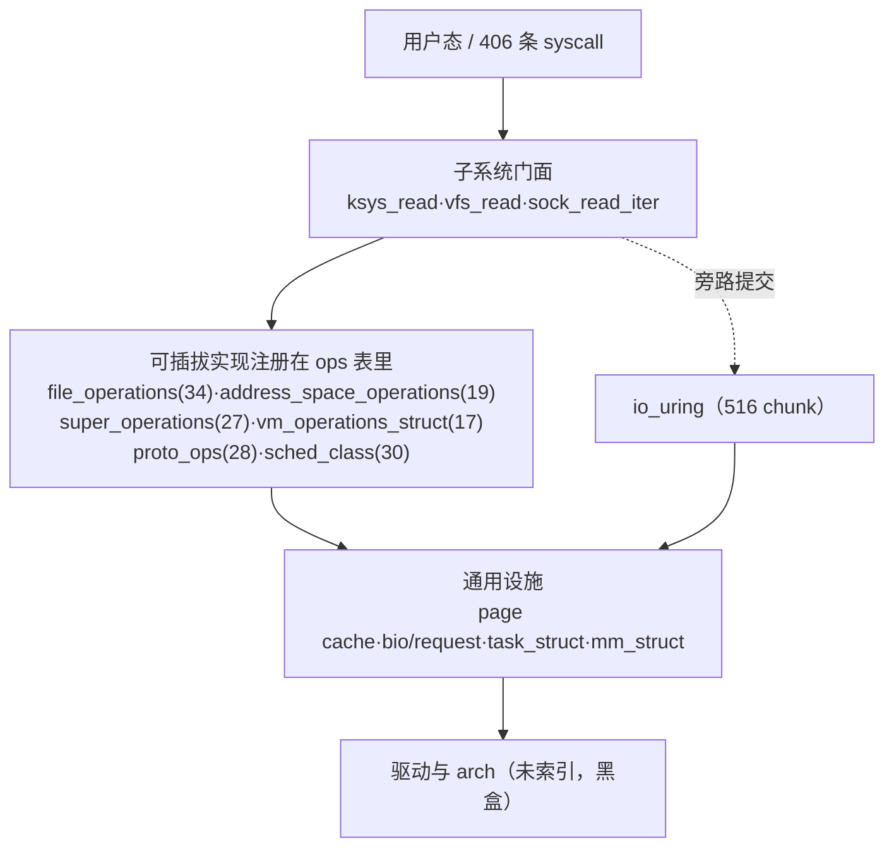
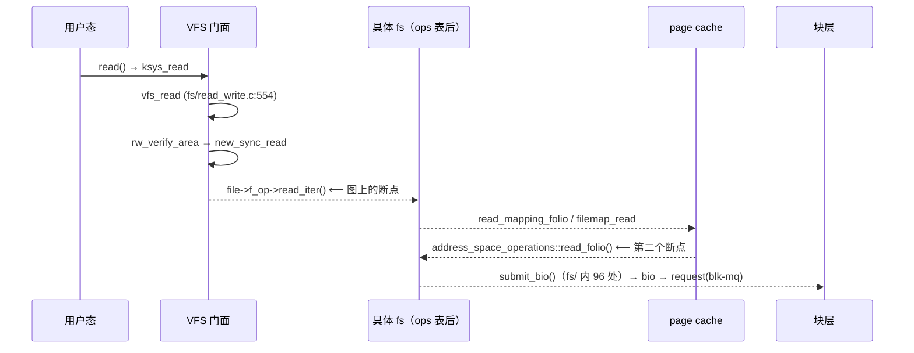

# Code Reading Report: Linux 7.2.12 内核源码架构

> **[static]** = 仅静态（`lens` / `call_graph.json` / 源码直读）；
> **[verified]** = 实际构建 + 运行/断点观测。

**本次全部结论为 `[static]`**：本机只有源码树 `/opt/linux/src/linux-7.2.12`，
无 `vmlinux`、无 qemu 引导记录。§5 的纵读是**静态调用链**，每步给 `file:symbol`，
但**无运行时栈背书**，验证方式见 §5 末。

---

## 1. Scope & method

**目的**（用户原话）：「用 lens 出一个项目源码级别的详细代码架构报告」——
要**架构骨架**，不是单子系统深挖。结构取「横向分层 + 扩展点 + 一条纵读路径」。

**方法**：按顶层目录切 8 个独立索引（`lens action=build path=<子目录> project=linux-<名>`）。
快照实测（`chunks_meta.jsonl` / `call_graph.json`）：

| project | 目录 | chunks | 节点 | 边 |
|---|---|---|---|---|
| `linux-fs` | `fs/` | 55661 | 20397 | 58129 |
| `linux-net` | `net/` | 47663 | 16105 | 37234 |
| `linux-kernel` | `kernel/` | 23952 | 7945 | 18767 |
| `linux-mm` | `mm/` | 8975 | 3186 | 6895 |
| `linux-security` | `security/` | 4706 | 1557 | 4306 |
| `linux-block` | `block/` | 3107 | 1027 | 2183 |
| `linux-io_uring` | `io_uring/` | 1256 | 516 | 934 |
| `linux-ipc` | `ipc/` | 400 | 142 | 263 |

**快照外**（「内核没有 X」这类结论一律不成立）：`drivers/`（22247 个 `.c`，完全没索引）、
`arch/`（没索引）。全树 36934 `.c` + 26899 `.h`；x86_64 系统调用表 406 条。

**能否跑通**：不能（无构建）。降级 = 源码直读 + 静态调用图，并逐条标 `[static]`。

---

## 2. Architecture overview（横向）                              [static]

内核不是分层蛋糕，而是**四层门面 + 六张函数指针表**的结构：稳定门面（高扇入、不依赖具体实现）
调用可插拔实现（`*_operations` 表），实现再落到通用设施（内存/块/调度）。



**主线判定的依据**（§4 的扇入法）：`vfs_*` 系列是稳定门面——`vfs_read`
（`fs/read_write.c:vfs_read`）的 callers 只有 `ksys_read` / `ksys_pread64` / `read_code`，
callees 只有 `new_sync_read` / `rw_verify_area`。**它的「实现层」在图上完全不存在**，
因为全部通过 `file->f_op->read_iter()` 走（见 §4）。

---

## 3. Core data structures                                        [static]

内核的架构可以从 13 个结构体推出来。定义位置用 `grep -n "^struct <名> {"` 实测：

| 结构 | 定义 | 角色 |
|---|---|---|
| `task_struct` | `include/linux/sched.h:826` | 调度/进程的一切；挂 `sched_class`、`mm_struct`、`fs_struct`、`cred` |
| `mm_struct` | `include/linux/mm_types.h:1160` | 地址空间根；挂 `vm_area_struct` 树、页表根 |
| `vm_area_struct` | `include/linux/mm_types.h:920` | 一段虚拟区间；挂 `vm_operations_struct`（缺页/回收回调） |
| `inode` | `include/linux/fs.h:762` | 磁盘对象的内存表示；挂 `address_space`、`super_block` |
| `address_space` | `include/linux/fs.h:472` | **page cache 的家**；挂 `address_space_operations` |
| `file` | `include/linux/fs.h:1255` | 打开实例；挂 `file_operations` + `f_pos` + `f_cred` |
| `dentry` | `include/linux/dcache.h:93` | 路径分量缓存；与 `inode` 多对一 |
| `super_block` | `include/linux/fs/super_types.h:132` | 一个挂载文件系统实例；挂 `super_operations` |
| `mount` | `fs/mount.h:47` | 挂载点（VFS 层，`vfsmount` 的实体） |
| `cred` | `include/linux/cred.h:115` | 权限主体，RCU 只读共享 |
| `bio` | `include/linux/blk_types.h:210` | 块 I/O 的最小描述（页向量 + 完成回调） |
| `request` | `include/linux/blk-mq.h:105` | 块层合并后的请求，由 blk-mq 分发 |
| `sk_buff` | `include/linux/skbuff.h:886` | 网络报文（线性区 + 分片 + 元数据） |

关系要点（`[static]`，来自定义直读）：

- **一个 `inode` 一个 `address_space`**：`inode->i_mapping` 指向它，page cache 就挂在
  `address_space->i_pages` 上，所以「文件缓存」是 inode 级而不是 file 级；
- **`file` 与 `inode` 是多对一**：同一 inode 可被多个进程打开，各自 `f_pos` 独立；
- **`mount` 与 `super_block` 是多对一**：bind mount / 多次挂载共享同一个 `sb`；
- **`bio` 是异步原语**：提交后靠 `bi_end_io` 回调，`request` 是它在块层的合并形态。

---

## 4. Extension points：六张 ops 表就是架构                [static]

槽数用 `awk '/^struct <名> \{/,/^\};/' <文件> | grep -cE '\(\*'` 实测（精确到函数指针成员）：

| 表 | 定义 | 槽 | 树内规模 | 谁注册 | 断链后果 |
|---|---|---|---|---|---|
| `file_operations` | `include/linux/fs.h` | 34 | 2001 个实例 | 每个文件系统/字符设备 | `vfs_read` 之后一切不可见 |
| `proto_ops` | `include/linux/net.h` | 28 | 每协议族一组 | `inet_stream_ops` 等 | `sock_read_iter` 之后不可见 |
| `super_operations` | `include/linux/fs/super_types.h` | 27 | 116 个 `file_system_type` 挂靠 | 各 fs 的 `*_ops` | 挂载/卸载/同步不可见 |
| `address_space_operations` | `include/linux/fs.h` | 19 | 每 inode 后端一份 | 各 fs 的 `*_aops` | page cache 回写不可见 |
| `vm_operations_struct` | `include/linux/mm.h` | 17 | 每 mmap 提供者一份 | 驱动/文件系统 | 缺页处理不可见 |
| `sched_class` | `kernel/sched/sched.h` | 30 | 6 个 `DEFINE_SCHED_CLASS` | stop/idle/rt/fair/dl/ext | 调度策略不可见 |

**关键认识**：`call_graph.json` 不带类型信息，`file->f_op->read_iter(...)` 这样的调用在图上
**完全消失**。所以「`vfs_read` 不调用任何文件系统」是错的，正确读法：

```bash
# 数实现者，而不是数调用边
grep -rn "\.read_iter\s*=\s*" --include=*.c fs/ | wc -l
lens action=grep pattern="\.read\s*=\s*" path=fs/        # 作用域 grep（整仓会被护栏拒）
```

`lens` 在可推断处会标注间接边：调用点为 `obj->fn()` 时图上带 `"indirect":true` + `"via"`，
`context` 显示 `name[via obj]`——**只是提示，不是精确边**。

---

## 5. Vertical analysis：一次 read() 的静态链                            [static]



静态校验点：

- `vfs_read` = `fs/read_write.c:554`，callers 3（`ksys_read`/`ksys_pread64`/`read_code`），
  callees 2（`new_sync_read`/`rw_verify_area`）——`context depth=2` 实测；
- `.read_iter` 实现在 `fs/` 内 **73 处**（`grep -rn "\.read_iter\s*=" --include=*.c fs/`），
  这就是 `vfs_read` 后面「消失」的全部实现层；
- page cache 侧入口 `read_mapping_folio` / `filemap_read`：
  `lens action=locate query="read_folio address_space_operations"` 的 top3 是
  `fs/ext4/verity.c`(0.948)、`fs/netfs/buffered_read.c`(0.891)、`fs/ntfs3/inode.c`(0.861)
  ——**全是具体 fs，没一个是 VFS 门面**（语义搜索天然偏向实现细节，别拿它当骨架）；
- 块层：`fs/` 内 `submit_bio(` 96 处 → `bio`(`blk_types.h:210`) → `request`(`blk-mq.h:105`)；
- `io_uring`（43 个 `.c`，516 节点）是**旁路**：`io_uring/*` 直接构造 `bio`/走
  `->read_iter`，绕过 `ksys_read`，所以只读 `fs/` 索引会**完全看不到**这条提交路径。

**如何升级为 `[verified]`**（本报告缺的一步）：`make defconfig && make -j` 出 `vmlinux`，
qemu 起机后在 `vfs_read` / `ext4_read_folio` / `submit_bio` 下断点跑 `dd if=/mnt/f`，
取 `bt` 与 §5 的链逐帧比对；帧不一致就说明这里断链判断错了。

---

## 6. Black boxes（有意不展开）

| 接口 | 输入 | 输出 | 作用 | 为何不开 |
|---|---|---|---|---|
| `drivers/` 全部 | bio/request、sk_buff | 完成回调 | 真正的硬件 I/O | 未索引（22247 个 `.c`） |
| `arch/x86` 入口 | `syscall_64.tbl` | `do_syscall_64` | 用户态进内核 | 未索引，只从架构无关侧看到 `ksys_read` |
| LSM（`security/`） | `security_hook_heads` | 允许/拒绝 | 权限裁决 | 1557 节点只是框架 |
| `net/` 协议族 | `sock`/`sk_buff` | `proto_ops` | 协议实现 | 47663 chunk，值得单独一份报告 |

---

## 7. Design commentary

- **六张 ops 表就是扩展点契约**：稳定门面与可插拔实现用函数指针表切开，
  让 `fs/` 在不认识任何文件系统的情况下完成读写。代价就是 §4 那张表——
  **任何静态分析工具都会在这里断链**，不是 lens 的缺陷，是 C 面向对象的天花板。
- **`address_space` 挂在 `inode` 而非 `file` 上**是对的：缓存必须在多个打开实例间共享，
  否则 `read()` 一致性崩。对照 `net/` 用 `sk_buff` 而非 `socket` 承载数据，同一思路：
  缓存归「对象」，不归「句柄」。
- **若我来设计**：给 ops 表加「表名 → 槽名」的可导出元数据（现在只能 grep `\.read\s*=`），
  让调用图能补 `virtual` 边——与 language server 的虚方法解析是同一问题。
- **可疑点**：`fs/` 内 `submit_bio(` 96 处、`.read_iter` 73 处，说明绕过 VFS 直接操作块层的
  路径大量存在（overlayfs/netfs/fuse）。「所有读都走 page cache」这类话必须先 grep 再写。

---

## 8. Follow-ups

- [ ] `[static]` → `[verified]`：按 §5 末的 qemu + 断点方案补运行时栈；
- [ ] `drivers/` 与 `arch/` 未索引，需要时按 `drivers/block`、`drivers/net` 单独建项目；
- [ ] `linux-net`（47663 chunk）值得独立一份报告：`proto_ops` 28 槽 + `sk_buff` 生命周期；
- [ ] `dataflow` 只做了单函数级，跨函数字段流（如 `i_state` 全部写入者）本次未做；
- [ ] `call_graph` 伪符号未净化，扇入榜需人工过一遍再引用。

---

**复现**（在 lite 仓库根；`cs` 封装见 `src/codesearch/code_search_best_practices.md` §2）：

```text
lens action=status  project=linux-fs
lens action=context query=vfs_read project=linux-fs depth=2
lens action=locate  query="read_folio address_space_operations" project=linux-fs
lens action=grep    pattern="\.read_iter\s*=" path=fs/ ext=c
```

槽数 / 实例数的原始命令（直接对源码树跑，不依赖索引）：

```bash
cd /opt/linux/src/linux-7.2.12
awk '/^struct file_operations \{/,/^\};/' include/linux/fs.h | grep -cE '\(\*'
grep -rn "struct file_operations [a-z_0-9]* *=" --include=*.c . | wc -l
grep -rn "DEFINE_SCHED_CLASS(" --include=*.c kernel/sched | wc -l
```
