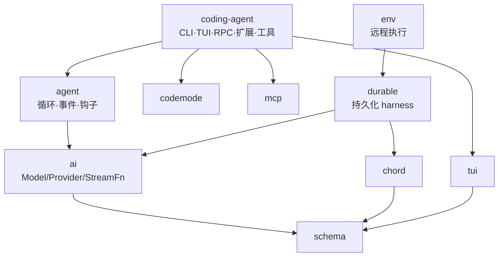
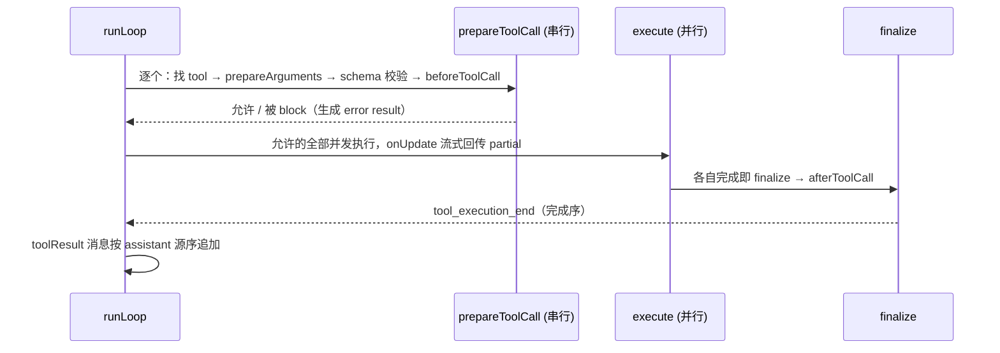

# pi-mono 源码级架构报告

> 对象：`/opt/pi-mono`（`@earendil-works/*` monorepo），读取日 2026-11-10。
> `[verified]` = 实测命令输出（文件数/行数/符号位置可复跑）；`[static]` = 仅静态阅读。
> 索引：lens project `pi-mono`，17022 chunks，KV/向量/调用图齐全（`lens action=status`）。
> 本文没有运行时实测——树里没有可用的构建产物，第 9 节列了怎么补。

---

## 0. TL;DR —— 十二句话

1. 12 个包 3063 个 `.ts` / 65.9 万行；核心三件套是 **`ai`（传输+模型目录）→ `agent`（循环+事件）→ `coding-agent`（产品外壳）**，依赖严格单向，编译顺序就写在根 `build` 脚本里。[verified]
2. `agent` 只有 6 个文件 2555 行，却是整个系统的心脏：`agentLoop()` 把「模型响应 → 工具执行 → 再请求」写成一个双层 `while`，外层管 follow-up，内层管 tool/steering。[static]
3. 所有可替换行为都是 `AgentLoopConfig` 上的钩子：`convertToLlm` / `transformContext` / `prepareRequest` / `finishTurn` / `prepareNextTurn` / `getSteeringMessages` / `getFollowUpMessages` / `beforeToolCall` / `afterToolCall`。[static]
4. `agent` 不认识任何 provider：它只收一个 `StreamFn`——`proxy.ts` 就是「把 LLM 调用转发到服务端」的同一接口实现，证明这层边界是真的。[static]
5. `ai` 是 provider 工厂：54 个 provider 实现 + 27 个 api 实现（anthropic-messages / openai-completions / bedrock-converse / mistral / google …），每个 API 一份 lazy 入口做按需加载。[verified]
6. 会话不是可变 transcript，而是 **append-only 树**（11 种 entry），上下文由 `buildSessionProjection()` 投影出来；`context_edit` 让「改历史某条对模型的贡献」也不需要重写文件。[static]
7. 压缩不是截断：`CompactionEntry` 带 `firstKeptEntryId` + 完整 `systemMessage`（prompt 与工具状态），阈值是 `contextTokens > contextWindow - reserveTokens`（默认 reserve 16K）。[static]
8. 工具并行是真并行但语义有讲究：**参数预检串行 → 允许的执行并行 → `tool_execution_end` 按完成序、toolResult 消息按源序**；批量早停要求同批**每个**结果都 `terminate:true`。[static]
9. 工具清单变化（loadout）以 **system 消息 delta（toolsAdded/toolsRemoved）** 声明进 transcript，保证「重放历史 = 当前可执行集合」。[static]
10. 扩展是 jiti 现场编译的 TS 模块，能加工具/命令/UI 组件/widget/自定义 provider/MCP server，还能改输入钩子与项目信任策略；插件市场式的 `package-manager.ts` 有 94KB。[static]
11. `codemode` 把「模型写 JS 在 QuickJS-WASM 里编排多次工具调用」变成一等公民：嵌套调用**不进 LLM 上下文**，只回最终结果——这是对抗上下文膨胀的结构性答案。[static]
12. 前端不是附属品：`tui` 独立成包（差分渲染 + CSI 2026 同步输出 + alt-screen 自管滚动），`chord` 是给 durable/UI 用的对象与热重载运行时（13.5 万行，仓库最大包）。[verified]

---

## 1. 方法与边界

### 1.1 用什么读的

- `lens action=status project=pi-mono` 对齐索引；`locate` 起手、`peek` 落地、`grep` 数结构。
- 规模、包边界、依赖方向全部用 `find`/`wc`/`package.json` 复跑，不靠印象。
- 深读顺序：`agent/src/{types,agent-loop}.ts` → `ai/src/{types,models}.ts` → `coding-agent/src/core/{session-manager,compaction,agent-session}.ts` → 外围包 README + 符号表。

### 1.2 明确**没**做

- 没有构建、没有跑测试（957 个 `*.test.ts`，构建需要 npm workspace 全链）。
- 没有逐行读 `ai/src/api/*` 的 27 份协议实现差异，只读了类型契约与分发方式。
- 没有读 `apps/p2`、`evals`、`telemetry` 的实现细节。
- `chord` 的 delta/host 只看 README 契约与文件规模——它是另一个量级的系统，值得单独一份报告。

### 1.3 复现

```bash
cd /opt/pi-mono
find packages -name '*.ts' -not -path '*/node_modules/*' -not -path '*/dist/*' | wc -l   # 2542
find packages -name '*.ts' -not -path '*/node_modules/*' -not -path '*/dist/*' -exec cat {} + | wc -l  # 562445
grep -A15 '"dependencies"' packages/*/package.json
lens action=status project=pi-mono
```

---

## 2. 横向：12 个包怎么分

### 2.1 实测规模 `[verified]`

| 包 | 职责（README 首段自述） | .ts 文件 | 行数 |
|---|---|---:|---:|
| `coding-agent` | 产品本体：CLI/TUI/RPC/扩展/工具/会话 | 716 | 171328 |
| `chord` | 跨进程对象 + facet 插件 + 热重载运行时 | 782 | 135636 |
| `durable` | 先落盘再显示的持久化 agent harness | 268 | 92557 |
| `ai` | 统一 LLM API、provider 集合、鉴权、成本 | 464 | 82616 |
| `tui` | 终端 UI 框架（差分渲染） | 100 | 41056 |
| `schema` | 无 `eval` 的 JSON Schema 构建+校验 | 62 | 8436 |
| `mcp` | 独立 MCP 客户端（不依赖官方 SDK） | 45 | 8099 |
| `agent` | 有状态 agent 循环 + 工具执行 + 事件流 | 17 | 7011 |
| `codemode` | QuickJS-WASM 里跑模型写的 JS | 28 | 5237 |
| `env` | 远程执行环境（Rust daemon + TS 客户端） | 20 | 4317 |
| `evals` | 评测 | 24 | 3449 |
| `telemetry` | 厂商中立的遥测契约 | 16 | 2703 |
| 合计（含 `apps/p2`） | | **3063** | **659777** |

超重文件说明重心在哪：

```
coding-agent/src/core/agent-session.ts   164KB
coding-agent/src/core/package-manager.ts  94KB
coding-agent/src/core/session-manager.ts  63KB
tui/src/components/editor.ts              83KB
chord/src/host/host.ts                    83KB
chord/src/delta/tracker.ts                82KB
```

### 2.2 依赖方向：一条直线，反向即循环

```
telemetry → schema → chord → tui → codemode → mcp → ai → durable → env → agent → coding-agent
```

根 `package.json` 的 `build` 脚本就是这条链的硬编码版本，顺序改错会直接炸 `tsc`。[verified]
`agent` 只依赖 `ai` + `schema`；`coding-agent` 依赖 `agent`/`ai`/`tui`/`codemode`/`mcp`——**没有任何包回指 `coding-agent`**，所以「换个外壳」在结构上是允许的。

### 2.3 分层视图



---

## 3. 骨架：`agent` 的循环与钩子

### 3.1 三个概念

| 概念 | 定义 | 台词 |
|---|---|---|
| `AgentContext` | `{ messages, tools }` | 模型可见的 transcript + 可执行工具集 |
| `AgentLoopConfig` | `extends SimpleStreamOptions`，约 15 个字段 | 全部可替换行为的插槽 |
| `AgentEvent` | 10 种事件的 union | UI 唯一订阅源 |

`agent/src/types.ts:514` 的 `AgentContext` 故意只有两个字段：**「能看见什么」和「能做什么」是分开的**，`tools` 不进 transcript，transcript 里只留 `system` 消息上的工具声明增量（见 3.4）。

### 3.2 双层循环（`agent-loop.ts:172 runLoop`）`[static]`

```ts
while (true) {                                    // 外层：follow-up
  let hasMoreToolCalls = true;
  while (hasMoreToolCalls || pendingMessages.length > 0) {    // 内层：tool / steering
    if (lastCompletedTurn) { ...config.prepareNextTurn?...; await emit({type:"turn_start"}) }
    注入 preparedMessages + pendingMessages
    const requestUpdate = await config.prepareRequest?.({context, model, thinkingLevel}, signal)
    const message = await streamAssistantResponse(...)         // 一次 provider 请求
    if (message.stopReason === "error" || "aborted") { finishTurn; turn_end; agent_end; return }
    const toolCalls = message.content.filter(c => c.type === "toolCall")
    // stopReason === "length" → 整批工具调用直接判失败，不执行半截参数
    const batch = message.stopReason === "length"
      ? await failToolCallsFromTruncatedMessage(toolCalls, emit)
      : await executeToolCalls(currentContext, message, config, signal, emit)
    hasMoreToolCalls = !batch.terminate
    const decision = await config.finishTurn?.(lastCompletedTurn, signal)
    await emit({ type: "turn_end", message, toolResults })
    if (decision?.action === "end") { await emit({type:"agent_end"}); return }
    explicitContinuation = decision?.action === "continue"
    pendingMessages = (await config.getSteeringMessages?.()) || []
  }
  const followUp = (await config.getFollowUpMessages?.()) || []
  if (followUp.length) { pendingMessages = followUp; continue }
  if (explicitContinuation) { explicitContinuation = false; continue }   // 「再跑一轮再停」
  break
}
```

四个值得记住的语义：

1. **steering 与 follow-up 是两件事**。steering 在当前 assistant 回合的工具跑完后注入（「边干边改」）；follow-up 只在 agent 本来要停时才取（「干完再说」）。
2. **`finishTurn` 的 `continue` 是「再请求一次」的显式凭证**：若这一轮没有工具调用/steering 自然接续，就为它单独跑一次 context-only 回合（`explicitContinuation`）；`end` 是硬退出。
3. **`stopReason === "length"` 的整批拒执行**（`failToolCallsFromTruncatedMessage`）：截断的工具参数宁可不执行，也不执行半截 `rm`/`patch`。
4. **prepareRequest 在每次请求前都能换模型/思考级别/上下文**（第一条也含），这是 coding-agent 接「虚拟模型路由」「压缩」的地方。

### 3.3 流式：partial message 原地替换 `[static]`

`streamAssistantResponse`（`agent-loop.ts:390`）在收到 `start` 事件时把 partial assistant message **push 进 context**，之后每个 `text_delta`/`toolcall_delta` 都执行：

```ts
context.messages[context.messages.length - 1] = partialMessage   // 假定的不变式：尾部就是它
await emit({ type: "message_update", message: { ...partialMessage }, assistantMessageEvent: event })
```

好处是 UI 拿到一份不断增长的快照、无需自己拼 delta；代价是**依赖「最后一条 assistant 就是本次流」这个隐含不变式**——钩子在流式期间往 context 里塞消息就会错位。`done`/`error` 时用 `result()` 换成终版并重新 emit `message_end`。

事件里每个 partial 都做了一次浅拷贝（`{ ...partialMessage }`）——这是故意为「订阅者持有旧事件」服务的，和「原地更新」是一对相反决策，两处都写在同 30 行里。

### 3.4 工具清单：以 system 消息 delta 声明 `[static]`

`declareToolChanges`（`agent-loop.ts:342`）在每次请求前比较「transcript 里最后一条 system 声明的工具集」与 `context.tools`，差异变成 `toolsAdded` / `toolsRemoved` 写进**新的 system 消息**。注释给出的理由是重放确定性：

> 当待处理 system 消息存在时，其工具字段视为意图，替换为「已提交 transcript」与「可执行集合」的 delta，所以 replay 永远精确得到 `context.tools`。

这条设计的价值：**工具可以中途增减**（coding-agent 的 loadout、`tool_search` 激活 deferred 工具），而依赖前缀缓存的 provider 仍看到单调追加的 transcript。

### 3.5 工具执行：三阶段 `[static]`



`executeToolCallsParallel`（`agent-loop.ts:596`）实现的就是上图的两种顺序：**事件按完成序**（UI 能立刻显示快的），**入上下文的 toolResult 按源序**（模型看到的调用-结果配对稳定）。批量早停（`shouldTerminateToolBatch`，`:700`）要求**所有** finalize 结果都 `terminate:true`——单条工具不能单方面停掉整批。

`runToolCall()`（`:821`）是单独导出的，`durable` 包复用它做「durable intent 已落盘、结果未知」的重放策略（`AgentTool.replay: "never" | "safe"`）。

---

## 4. 数据结构地图

### 4.1 会话文件：11 种 entry（`core/session-manager.ts:57-197`）`[static]`

`SessionHeader` + 每行一个 `SessionEntry`，全部带 `id` / `parentId` / `timestamp`：

| entry `type` | 参与模型上下文 | 作用 |
|---|---|---|
| `message` | 是 | 普通消息（AgentMessage） |
| `custom_message` | 是 | 扩展注入的 user 消息，`display` 控 TUI 渲染 |
| `compaction` | 是（作为边界） | 摘要 + `firstKeptEntryId` + `tokensBefore` + `systemMessage` |
| `branch_summary` | 是 | 树导航离开分支时的摘要（`fromId`） |
| `context_edit` | **改写** | append-only 地改/删某条历史 entry 对上下文的贡献 |
| `thinking_level_change` / `model_change` | 否 | 状态变更 |
| `usage` | 否 | 分类记账（如 `cache_warm`） |
| `custom` | 否 | 扩展私有状态（reload 后自恢复） |
| `label` / `session_info` | 否 | 书签 / 会话名 |

`parentId` 让整个会话是一棵**树**：`branch()` / `branchWithSummary()` / `navigateTree()` 都只动 leaf 指针，不复制文件。`SessionHeader.parentSession` 再记录「这个会话文件是从哪个文件 fork 出来的」。

### 4.2 projection：append-only 如何变成上下文 `[static]`

```ts
interface ProjectedSessionEntry { sourceEntry: SessionEntry; messages: AgentMessage[] }
interface SessionProjection { entries; messages; thinkingLevel; model }
```

`buildSessionProjection()`（`:1504`）从 leaf 沿 `parentId` 回溯，逐条处理：

- `context_edit`：`replacement: null` → 目标被**省略**；否则只替换目标 entry 的 `content`，消息元数据（时间戳/id）保留。
- `compaction`：成为新的起点，`firstKeptEntryId` 之后的条目才继续累加。
- `custom` / `label` / `usage`：跳过。

**为什么值得这个复杂度**：一是「编辑历史」不破坏 append-only 性质（审计/重放仍然逐字节一致）；二是压缩后的增量视图不需要重写整个文件；三是树分支天然支持「回到某个点重开」。

### 4.3 压缩的真实形状（`core/compaction/compaction.ts`）`[static]`

```ts
export const DEFAULT_COMPACTION = { reserveTokens: 16384, ... }      // :122-128
export function shouldCompact(contextTokens, contextWindow, settings) {
  return contextTokens > contextWindow - settings.reserveTokens;     // :269
}
```

- 触发点是**预留空间**而不是百分比：给下一轮请求留 16K，避免「刚好塞满再压」。
- 摘要用固定结构化 prompt（Objectives / [Preserve existing goals] / Decisions / Next steps 等小节），`completeSummarization`（`:612`）是**所有**压缩/分支摘要的唯一收口，带 `RetryPolicy` 与「确定性错误不重试」。
- `CompactionEntry.systemMessage` 存边界处的**完整 system 消息**（含工具声明），所以重启后重放不依赖当前配置。
- 压缩与分支摘要是**迭代**的：新摘要基于旧摘要 + 增量段落，`collectFileOps` 把读写过的文件列表单独抽出来传给模型（`utils.ts` 的 `computeFileLists`/`formatFileOperations`）。

---

## 5. 纵切：一条用户消息的 12 跳 `[static]`

```
① AgentSession.prompt(text)                        agent-session.ts:2121
②   _preparePrompt                                 :2180
      - _runInputHandlers（扩展可拦截/改写/吞掉）
      - 展开 /skill:name 与 prompt template
      - 队列：isStreaming 时按 steering/follow-up 模式入队
      - 鉴权/模型校验（preflightResult 回调给 UI）
③   _startRun → Agent.prompt
④     Agent → runAgentLoop → runLoop                agent-loop.ts:172
⑤       prepareRequest 钩子（coding-agent 在此挂压缩检查 :808/:3203）
⑥       streamAssistantResponse                     agent-loop.ts:390
          transformContext → convertToLlm → normalizeContext
          getApiKey(provider)（短期 OAuth token 每请求重解析）
          streamFn(model, context, options)          ← 边界：agent 只认这个
⑦          ai: ModelsImpl → Provider → api 实现（27 选 1）
              SSE/WS 解析 → AssistantMessageEvent 流
⑧       toolCall 批量执行                            agent-loop.ts:596
          prepareToolCall（串行）→ beforeToolCall（权限/信任）
          → execute（并行, onUpdate 回传）
          → afterToolCall → finalize
⑨       SessionManager.appendMessage(entry)          session-manager.ts:1215
          每跳落盘一行 JSONL + 更新 tail 索引
⑩       getSteeringMessages / finishTurn / getFollowUpMessages
⑪       compaction 触发（若超阈值）→ 写 CompactionEntry → 重新投影
⑫     agent_end → AgentSessionEvent 广播给 TUI / RPC / JSON 模式
```

三个「钩子被谁占」的实测落点：

| 钩子 | coding-agent 的实现 | 目的 |
|---|---|---|
| `prepareRequest` | 包装 `agent.prepareRequest`（:808） | 虚拟模型路由 + 压缩前置 |
| `finishTurn` | 包装 `agent.finishTurn`（:907） | 判断是否继续、写 usage、刷新 footer |
| `transformContext` | :1817 / :1838 两层包裹 | 截断大结果、注入 reminder |
| `beforeToolCall` | extensions runner | 项目信任 / 权限拒绝 → error tool result |
| `afterToolCall` | extensions runner + truncate | 输出守卫（`output-guard.ts`）、压缩结果 |

### 5.1 工具集：8 个内置 + 5 类曝光 `[static]`

`core/tools/` 下：`bash` / `read` / `write` / `edit` / `grep` / `find` / `ls` / `powershell`（+ `file-mutation-queue.ts` 把同文件写串行化、`truncate.ts`、`output-accumulator.ts`）。

`ToolExposure`（`extensions/types.ts:536`）有五个级别：

| 值 | 含义 |
|---|---|
| `direct` | 直接进模型工具清单 |
| `model-only` | 能调但不在某些渲染/搜索面出现 |
| `codemode` | 只在 codemode 脚本里可用（不进主清单） |
| `deferred` | 靠 `tool_search` 激活（省前缀） |
| `hidden` | 内部用 |

这就是「工具很多但上下文不炸」的机制：MCP 工具默认 `codemode`/`deferred`，模型先 `tool_search` 再激活。

---

## 6. `ai` 包：provider 工厂的三层

### 6.1 类型契约 `[static]`

```ts
interface Model<TApi> {               // ai/src/types.ts:864
  api: TApi; provider: ProviderId; id: string;
  reasoning: boolean; thinkingLevelMap?; promptCache?;
  contextWindow: number; maxTokens: number;
  samplingParams?; samplingParamsByThinkingLevel?; compat?;
}

interface Provider<TApi> {            // ai/src/models.ts:158
  id; name; baseUrl?; headers?; auth: ProviderAuth;
  getModels(): readonly Model<TApi>[];
  getAllModels?(); refreshModels?(ctx): Promise<void>;
}
```

`Model` 有三种 `type`：`chat`（默认）/ `image` / `classifier`，共用 `BaseModel` 但操作不同（`stream` / `generateImages` / `classify`）。`compat` 字段按 api 做条件类型——同一个 `openai-completions` API 下，不同网关的怪癖（字段名、system 位置、tool_choice 支持）收敛成一个 `OpenAICompletionsCompat` 对象。

### 6.2 分发链 `[static]`

```
ModelsImpl.getModel(id) → Model
streamSimple(models, model, ctx, opts)
  → model.api = "anthropic-messages" | "openai-responses" | ...  （27 种）
  → api 实现的 stream() → ProviderResponse / AssistantMessageEventStream
```

每个 api 都有 `.lazy.ts` 兄弟（如 `anthropic-messages.lazy.ts`），把重 SDK（`@anthropic-ai/sdk`、`@google/genai`、`@aws-sdk/...`）推迟到真正用到该 provider 时再 import。`legacy-api-aliases.ts` 做旧 api 名映射。

### 6.3 鉴权与凭据 `[static]`

- `ProviderAuth = { apiKey | oauth }`，**每个 provider 都必须有 auth 语义**（连无 key 的本地 server 也用 `apiKey` 表示「已配置」）；`getAuth()` 未配置返回 undefined。
- `auth/context.ts`：默认从 `process.env` 读、`node:fs` 探文件（浏览器里恒 false），同一份代码能跑在 Node/Bun/CF Workers。
- `auth/credential-store.ts`：内存实现按 provider 串行化写（promise chain），持久化交给宿主注入。
- `oauth/` 处理 Copilot / Anthropic / Codex 等登录流。

### 6.4 模型目录是生成的 `[verified]`

`models.generated.ts` + `providers/data/.manifest.json`；根脚本 `generate:models` / `hydrate:model-data` / `check:model-data` 负责同步。54 个 provider 文件里 `*.models.ts` 是目录数据，同名 `.ts` 是行为（baseUrl/headers/auth/动态刷新）。

---

## 7. 外围包：各自解一个不同的题

| 包 | 一句话 | 关键接口 |
|---|---|---|
| `tui` | 差分渲染终端框架；`TUI` 接口两个实现（main-screen / alt-screen） | `Component.render()`、`showOverlay()`、CSI 2026 同步输出 |
| `codemode` | 模型写 JS 在 QuickJS-WASM 里编排工具 | `CodemodeSandbox` / `RemoteCodemodeSandbox`；脚本里 `tools`/`ALL_TOOLS`/`text`/`image`/`exit`/`store`/`load` |
| `mcp` | 手写 MCP 客户端 | `McpClient` + Stdio / Streamable HTTP / in-memory transport |
| `chord` | 跨进程对象 + facet 插件 + 热重载 | object type / facet / reference / document / job / principal |
| `durable` | 先提交再显示的 harness | 会话/回合/工具调用先落 storage 再展示；进程死掉重开继续 |
| `env` | 远程执行环境 | Rust daemon（framed stdio 协议）+ `RemoteExecutionEnv` |
| `schema` | 无 eval 的 JSON Schema | 编译成闭包，2020-12 + draft7，2222/2223 官方测试 |
| `telemetry` | 遥测契约 | `TelemetryContext` / `TelemetrySpan` 回调式 |

### 7.1 `tui` 的两个决策 `[static]`

1. **双渲染器**：`tui-main-screen.ts`（滚入终端历史）与 `tui-alt-screen.ts`（全屏自管滚动），共享 `TUI` 接口（`tui.ts:470`）。应用层只对 `Component.render()` 编程。
2. **差分 + 同步输出**：只重绘变化行/视口行，用 `CSI 2026` 把一帧包成原子操作防闪烁；`fullRedraws` 计数暴露给调试。**应用自己管滚动**（mouse/trackpad/keyboard），所以不是「终端在滚」。

`keys.ts` 48KB、`editor.ts` 83KB 说明：键位解析（含 CJK、kitty protocol）与编辑器（多行、粘贴标记、补全）占了框架一半体量——终端 UI 的真实成本在输入侧。

### 7.2 `codemode` 为什么存在 `[static]`

模型调 10 次工具 = 10 次 provider 往返 + 10 份结果进上下文。codemode 让它写一段 JS，在 QuickJS-VM 里跑，`tools.foo()` 的实际调用**不进上下文**，只回脚本 `return`/`text()` 的内容。`NestedToolCalls`（`ai/src/types.ts:642`）只作为 session 记录保留，且带大小上限（`argumentsBytes` 替代超大参数）。

Node 下一个 worker thread 一次执行；Cloudflare 下换成 Durable Object（`RemoteCodemodeSandbox`）——**同一套 API、同一份脚本环境、同一种结果格式**。

---

## 8. 设计评注

### 8.1 一个 `StreamFn` 切断全部 provider 依赖

`agent` 的核心签名只有一个函数参数（`types.ts:33`）：

```ts
type StreamFn = (model, context, options) => ProviderResponse
```

`proxy.ts` 用同一个签名实现「把请求发给自己的服务器」，证明这层不是摆设：换传输、换网关、换服务端集中鉴权，都不用改循环。**对比** `ai` 的 54 个 provider 实现——扩展点在上层是「函数」，在下层是「目录」，两级抽象各管一段。

### 8.2 append-only 树 vs opencode 的 SQLite 九表

见 `codesearch/opencode-source-report.md`：opencode 用 SQLite 九张表 + durable inbox 换「进程崩了能续」；pi-mono 走 JSONL 行 + `parentId` 树 + 投影。

| | pi-mono | opencode |
|---|---|---|
| 存储 | 一行一个 entry 的 JSONL | SQLite 九表 |
| 「编辑历史」 | `context_edit` 追加，投影时生效 | 改行 |
| 分支 | `parentId` 天然树 | 需要额外表 |
| 审计/重放 | 文件即日志，`grep` 可查 | 需要导出 |
| 并发写 | 单写者（文件） | SQLite 事务 |

「可 grep 的会话」本身是产品能力：`--print` 的 JSONL 导出、bug-report 摘要都直接吃这个格式。

### 8.3 压缩的三个不寻常之处

1. **阈值是预留制**（`contextWindow - 16384`），不是比例。
2. **摘要带完整 system 状态**（`CompactionEntry.systemMessage`），因此重放与当前配置解耦。
3. **压缩是唯一收口**（`completeSummarization`）：压缩与分支摘要共用重试/失败分类，避免两套 LLM 调用逻辑各自漂移。

### 8.4 缓存是刻意维护的一等目标

- `ai` 的 `Model.promptCache` 显式声明 provider 缓存生命周期分档；`openai-prompt-cache.ts` 处理自动缓存请求头。
- `coding-agent/src/core/cache-warmer.ts` + `cache-stats.ts`：会话空闲时保活上一次请求的前缀缓存（`AgentSessionConfig.cacheWarmer`）。
- `declareToolChanges` 的 delta 设计同样服务于「不打断前缀」。

### 8.5 若我重来会改什么

- **`runLoop` 应是显式状态机**。现在靠 `hasMoreToolCalls` / `pendingMessages` / `explicitContinuation` 三个变量交织出 4 层嵌套，读起来要模拟执行；一个 `type Phase = "request" | "tools" | "drain" | "done"` 会少一半解释成本。
- **`AgentContext` 应带「当前 assistant 尾部索引」**，而不是让 `streamAssistantResponse` 假设 `messages[len-1]` 就是本次流。
- **`coding-agent/core/agent-session.ts` 需要拆包**：164KB、一个类承担 prompt/工具装载/压缩/树导航/扩展绑定/导出/统计。至少 `ToolLoadout` 与 `SessionOps` 应各自成文件。

### 8.6 可疑点

| 点 | 证据 | 判断 |
|---|---|---|
| `package-manager.ts` 94KB 住在 `core/` | 文件规模 | 包安装是独立领域，可下沉 |
| `SessionEntry.type` 用字符串而非贴合同步 | 11 个 interface 各自 `type` 字面量 | 迁移靠 `migrateToCurrentVersion` 兜底，长期会漏 |
| `chord` 13.5 万行放在同一 monorepo | 规模 | 与 agent 主线关系弱，独立版本节奏更合适 |
| `agent-session.ts` 里 `_isEmittingAgentSettled` + 延迟动作队列 | :2121 起 | 重入保护，但说明事件与命令边界不够干净 |

---

## 9. 黑盒（本报告不展开）

| 接口 | 输入 | 输出 | 为何不开 |
|---|---|---|---|
| `ai/src/api/*`（27 份） | `context` + `StreamOptions` | `AssistantMessageEventStream` | 协议差异巨大，逐份读性价比低；契约已在 §6.1 |
| `chord/src/host` + `delta` | facet / 对象调用 | 引用、事务、热重载 | 独立系统，13.5 万行，应单独报告 |
| `durable/src/harness` | 存储 + 模型 | 崩溃可续的回合 | 只读了 README 契约 |
| `env/daemon`（Rust） | framed stdio | 文件/命令结果 | 另一语言栈 |
| `schema` 编译器 | JSON Schema | 校验闭包 | 只需知道「无 eval、误差路径用 JSON Pointer」 |
| `codemode` wasm 宿主 | 脚本 | 结果 + 嵌套调用记录 | 只需知道边界：嵌套调用不进上下文 |

---

## 10. Follow-ups

- [ ] `[static]` 待验证：跑一次 `coding-agent --print` 抓 session JSONL，确认 entry 顺序与 `context_edit` 投影行为。
- [ ] 未开：`ai/src/api/anthropic-messages.ts`（69KB）与 `openai-completions.ts`（62KB）的工具调用流式解析差异。
- [ ] 未开：`chord` 的 facet/热重载规则（README 指向 `docs/design.md`）。
- [ ] 未开：`durable` 的「请求杀进程也重试」实现（`harness/` 下重试账本）。
- [ ] 待补索引：`apps/p2`、`packages/*/test` 没进 pi-mono 索引，测试驱动的契约（957 个测试文件）还没利用。

---

## 11. 阅读路线（按小时）

| 时段 | 读什么 |
|---|---|
| 第 1 小时 | `agent/src/types.ts`（钩子清单）→ `agent-loop.ts:172-342`（双层循环） |
| 第 2 小时 | `agent-loop.ts:390-700`（流式 + 工具三阶段）→ `types.ts:420-560`（Tool/Result） |
| 第 3 小时 | `ai/src/types.ts`（Message/Model/StopReason）→ `models.ts:158`（Provider） |
| 第 4 小时 | `coding-agent/core/session-manager.ts:43-250`（11 种 entry）→ `buildSessionProjection` |
| 第 5 小时 | `compaction/compaction.ts`（预留阈值 + 摘要收口）→ `agent-session.ts:2121`（prompt 12 跳） |
| 第 6 小时 | `core/extensions/types.ts`（ToolExposure/钩子）→ `tools/` 8 个内置工具 |
| 选读 | `tui/src/tui.ts:470`（TUI 接口）→ `codemode/src/types.ts`（沙箱契约） |

---

## 附：一页速查

```
包依赖（根 build 顺序）
  telemetry → schema → chord → tui → codemode → mcp → ai → durable → env → agent → coding-agent

核心文件
  agent/src/agent-loop.ts:172   runLoop（双层 while）
  agent/src/agent-loop.ts:390   streamAssistantResponse（partial 原地替换）
  agent/src/agent-loop.ts:596   executeToolCallsParallel（完成序事件 / 源序消息）
  agent/src/agent-loop.ts:342   declareToolChanges（system delta）
  agent/src/types.ts:193        AgentLoopConfig（9 个钩子）
  agent/src/types.ts:514        AgentContext { messages, tools }

  ai/src/types.ts:864           Model<TApi>
  ai/src/models.ts:158          Provider
  ai/src/providers/all.ts       54 个 provider 汇总

  coding-agent/src/core/session-manager.ts:988   SessionManager
  coding-agent/src/core/session-manager.ts:57    11 种 SessionEntry
  coding-agent/src/core/compaction/compaction.ts:269  shouldCompact
  coding-agent/src/core/agent-session.ts:2121    prompt()

关键不变量
  · transcript 只追加；改历史 → context_edit（投影生效）
  · 压缩后 resume 依赖 CompactionEntry.systemMessage
  · toolResult 消息顺序 = assistant 源序；事件顺序 = 完成序
  · 批量早停：全部 terminate:true 才停
  · 工具集变化只以 system delta 表达

事件（10 种）
  agent_start/end · turn_start/end · message_start/update/end
  · tool_execution_start/update/end

规模（[verified]）
  12 包 3063 ts / 659777 行；957 个 *.test.ts
  agent 6 文件 2555 行 = 心脏
```
