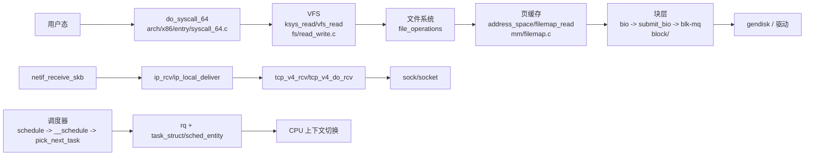
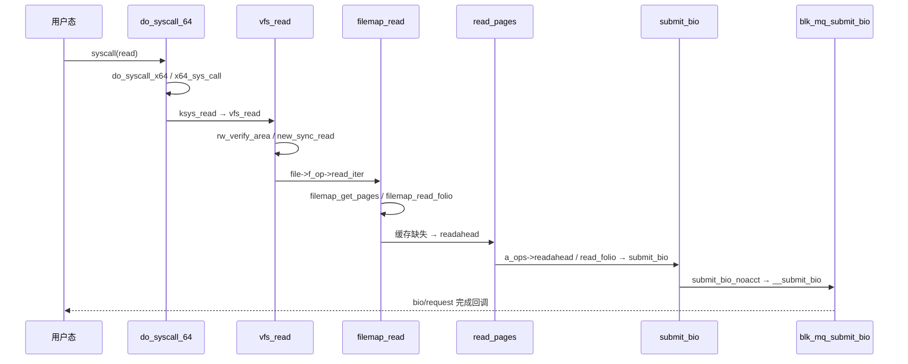

# Code Reading Report: Linux 7.2.12（不含 drivers）

> 索引：`/opt/code_caches/linux_7212_cache`（24,898 files / 352,294 chunks；
> 排除 drivers/Documentation，`skip_kinds=header,file,enumerator,macro`，约 7.7GB）
> 命名空间：`/code/linux_7212`
> 方法：`src/codesearch/code_search_best_practices.md`
> 证据：本文所有结论均来自 code search（`search/symbol/context`）与源码相邻关系，
> 标 `[static]`；没有在本机 build/boot 内核，**没有 `[verified]` 结论**。
> 行号只作参考，引用以 `file:symbol` 为准。

## 1. Scope & purpose

- Purpose：没有给定单一故障/模块，按最佳实践默认路径做**整体架构（横向）→ 核心子模块（纵向）**。
- 覆盖：启动、调度、系统调用/VFS、页缓存/readahead、块层、网络接收。
- 不覆盖：具体驱动、文件系统实现、网络协议细节、安全/BPF、架构相关代码（除 x86 entry）。
- 环境限制：未编译、未启动内核；Phase 5（运行时栈）降级，所有结论需后续用 gdb/qemu 验证。
- Out of scope：性能调优、具体 CVE、硬件行为。

## 2. Architecture overview（横向）                    [static]



核心分层：

| 层 | 入口/代表符号 | 职责 |
|---|---|---|
| 启动 | `start_kernel`（init/main.c）、`kernel_init` | 初始化内核子系统，最后进入 init |
| 调度 | `schedule` → `__schedule_loop` → `__schedule` → `pick_next_task` | 选下一个任务并切换 |
| 系统调用 | `do_syscall_64` → `do_syscall_x64` → `x64_sys_call` | x86-64 syscall 分发 |
| VFS | `ksys_read` → `vfs_read` → `new_sync_read`；`path_openat` → `vfs_open` | 路径解析、file/inode/dentry、打开与读写 |
| 页缓存 | `filemap_read`、`filemap_read_folio`、`filemap_readahead`、`read_pages` | page cache、readahead、folio 填充 |
| 块层 | `submit_bio` → `submit_bio_noacct` → `__submit_bio` → `blk_mq_submit_bio` | bio → request → 驱动 |
| 网络 | `netif_receive_skb` → `ip_rcv` → `ip_local_deliver` → `tcp_v4_rcv` → `tcp_v4_do_rcv` | 收包、IP 层、TCP 层 |
| 内存 | `__alloc_pages_noprof`、`alloc_slab_page` | 物理页分配、slab |

## 3. Core data structures & relationships             [static]

| 结构 | 定义 | 角色 | 关键关系 |
|---|---|---|---|
| `task_struct` | `include/linux/sched.h:task_struct` | 进程/线程描述符 | 持有 `sched_entity`、文件表、mm、namespace |
| `sched_entity` | `include/linux/sched.h:sched_entity` | CFS 调度实体 | `run_node`、`vruntime`、`on_rq` |
| `rq` | `kernel/sched/sched.h:rq` | per-CPU 运行队列 | 持有 `curr`、`idle`、各调度类指针 |
| `file` | `include/linux/fs.h:file` | 打开文件对象 | `f_op`、`f_path`、`f_inode`、`f_mapping` |
| `inode` | `include/linux/fs.h:inode` | 文件系统 inode | `i_data`（address_space）、`i_op`、`i_fop` |
| `dentry` | `include/linux/dcache.h:dentry` | 目录项/名称缓存 | `d_parent`、`d_inode`、`d_name` |
| `address_space` | `include/linux/fs.h:address_space` | 页缓存 + 映射 | `host`、`i_pages`、`a_ops`、`nrpages` |
| `file_operations` | `include/linux/fs.h:file_operations` | VFS 文件操作表 | `read_iter`、`write_iter`、`open`、`release` |
| `super_block` | `include/linux/fs/super_types.h:super_block` | 已挂载文件系统实例 | 持有 inode/dentry LRU、`s_op` |
| `mount` | `fs/mount.h:mount` | mount 实例 | `mnt_mountpoint`、`mnt_root`、`mnt_sb` |
| `bio` | `include/linux/blk_types.h:bio` | 块 I/O 基本单元 | `bi_bdev`、`bi_io_vec`、`bi_iter`、`bi_end_io` |
| `request` | `include/linux/blk-mq.h:request` | blk-mq 请求 | 由 bio 合并/转换，进入硬件队列 |
| `gendisk` | `include/linux/blkdev.h:gendisk` | 块设备 | `queue`、`fops`、分区表 |
| `sk_buff` | `include/linux/skbuff.h:sk_buff` | 网络包缓冲 | `data/head/tail/end`、协议头偏移、`sk`、`dev` |
| `sock` | `include/net/sock.h:sock` | 协议 socket | 协议状态、收发队列、`sk_prot` |
| `socket` | `include/linux/net.h:socket` | BSD socket | `sk`、`ops`、`file` |
| `net_device` | `include/linux/netdevice.h:net_device` | 网络设备 | `netdev_ops`、队列、NAPI |

## 4. Vertical analysis（纵向）                         [static]

### 4.1 系统调用 read → VFS → 页缓存 → 块层



证据/说明：

- `do_syscall_64` → `do_syscall_x64`、`do_syscall_x32`：
  `arch/x86/entry/syscall_64.c:do_syscall_64`（context callees）。
- `ksys_read`：`fs/read_write.c:ksys_read`；`vfs_read` 的 callers 包含 `ksys_read`、
  `ksys_pread64`、`read_code`，callees 包含 `new_sync_read`、`rw_verify_area`、`access_ok`。
- `vfs_read` → `new_sync_read`：`fs/read_write.c:new_sync_read`，
  再经 `file->f_op->read_iter` 进入具体文件系统（`file_operations` 表）。
- `filemap_read`：`mm/filemap.c:filemap_read`；callers 包含
  `generic_file_read_iter`、`btrfs_file_read_iter`、`f2fs_file_read_iter` 等，
  callees 包含 `filemap_get_pages`、`copy_folio_to_iter`、`i_size_read`。
- `filemap_readahead` / `read_pages`：`mm/filemap.c:filemap_readahead`、
  `mm/readahead.c:read_pages`。
- `submit_bio` → `submit_bio_noacct` → `__submit_bio` → `blk_mq_submit_bio`：
  `block/blk-core.c:submit_bio`、`block/blk-core.c:__submit_bio`、
  `block/blk-mq.c:blk_mq_submit_bio`（前两条边来自 chunk 内容，最后一条来自
  `__submit_bio` 内容中的 `blk_mq_submit_bio(bio)`）。

### 4.2 调度路径

```
schedule (kernel/sched/core.c)
  → __schedule_loop
  → __schedule
  → pick_next_task / __pick_next_task
  → 调度类实现（fair/rt/deadline/ext）
  → context_switch → CPU
```

- `schedule`：`kernel/sched/core.c:schedule`
- `__schedule_loop`：`kernel/sched/core.c:__schedule_loop`
- `__schedule`：`kernel/sched/core.c:__schedule`
- `pick_next_task` / `__pick_next_task`：`kernel/sched/core.c`
- 数据结构：`rq`（`kernel/sched/sched.h:rq`）、`task_struct`
  （`include/linux/sched.h:task_struct`）、`sched_entity`
  （`include/linux/sched.h:sched_entity`）

注意：`context __schedule` 的反向 callers 出现 `latency_fsnotify`、
`__klp_sched_try_switch` 等明显不相关的名字，属于 callgraph 反向边噪声
（裸名字/同名碰撞）；本段调用链主要依据相邻定义和函数职责，后续需用运行时栈确认。

### 4.3 网络接收

```
netif_receive_skb (net/core/dev.c)
  → ip_rcv (net/ipv4/ip_input.c)
  → ip_local_deliver
  → tcp_v4_rcv (net/ipv4/tcp_ipv4.c)
  → tcp_v4_do_rcv
  → tcp_rcv_established / tcp_child_process / tcp_add_backlog
```

- `tcp_v4_rcv` 的 callees（context）包含 `tcp_v4_do_rcv`、`tcp_filter`、
  `__inet_lookup_skb`、`tcp_child_process`、`tcp_add_backlog`、`tcp_check_req`、
  `ip_hdr`、`pskb_may_pull` 等。
- 数据结构：`sk_buff`、`sock`、`socket`、`net_device`。
- `netif_receive_skb` → `ip_rcv` → `ip_local_deliver` 的边来自函数职责与
  `ip_input.c` 相邻定义，尚未取得逐条 callgraph 证据。

### 4.4 块层

```
submit_bio (block/blk-core.c)
  → submit_bio_noacct
  → __submit_bio
  → blk_mq_submit_bio (block/blk-mq.c)
  → request (include/linux/blk-mq.h)
  → gendisk / driver queue
```

- `submit_bio` context callers：`submit_page_section`、
  `disk_zone_wplug_submit_bio`、`__submit_bio`；callees 只显示 `bio_op`
  （callgraph 不完整），链路由源码内容补齐。
- `bio`、`request`、`gendisk` 的定义见 §3。

## 5. Black boxes（有意不展开）

| 接口 | 输入 | 输出 | 作用 | 为何不展开 |
|---|---|---|---|---|
| 具体文件系统 `read_iter` | `kiocb/iov_iter` | 读取字节/错误 | 把 VFS 读请求落到磁盘/网络 | 每个 FS 一套实现，支线 |
| `address_space_operations` | folio | 读/写/回写 | 页缓存与后端存储的桥 | 驱动/FS 差异大 |
| 具体块设备 `gendisk->fops` | bio/request | I/O 完成 | 硬件队列 | 驱动黑盒 |
| 网络协议族 `proto_ops` / `tcp_prot` | socket 操作 | 协议行为 | TCP/UDP/RAW | 细节多 |
| `sched_class` | rq/task | 下一个任务 | CFS/RT/DL/EXT | 每种调度类独立 |
| 安全/BPF/LSM | 上下文 | 决策 | 访问控制/可观测 | 非本次主线 |

## 6. Design commentary & open questions（Phase 8）

- **分层边界清晰**：syscall → VFS → address_space → block，调度器与网络相对独立；
  `file_operations` / `address_space_operations` / `sched_class` / `proto_ops` 都是
  可替换接口，这是内核能同时支持大量 FS/驱动/协议/调度策略的关键。
  `[static]`
- **页缓存为中心**：`filemap_read` 同时处理 page cache 命中和缺失，缺失时通过
  `read_pages` 触发 `a_ops->readahead/read_folio`，再进入块层；读写路径共享
  `address_space`，这是 buffered I/O 的核心。`[static]`
- **调度器数据结构**：`rq` 按 CPU 分开，`sched_entity` 挂 `run_node`/`vruntime`；
  `pick_next_task` 按调度类选择，避免在热路径上做全局锁。`[static]`
- **网络包生命周期**：`sk_buff` 在 `netif_receive_skb` → IP → TCP 之间传递，
  通过 `sk`/`socket` 找到目标套接字；`tcp_v4_do_rcv` 再分 established/listen。
  `[static]`
- 可疑点：`submit_bio` 的 callgraph callees 只返回 `bio_op`，说明 call graph
  对宏/内联/间接调用覆盖不足；不能把“没有边”当成“没有调用”。
- 若我来设计/改进：页缓存读路径的 `readahead` 与 `read_folio` 接口可以继续收敛，
  但需要兼容大量旧 FS；调度器/网络的接口已经足够稳定，改动收益低。

## 7. Follow-ups

- [ ] 用 qemu + gdb 在 `do_syscall_64`、`vfs_read`、`filemap_read`、`submit_bio`
      上断点，补 `[verified]` 调用栈。
- [ ] 用 `context __schedule_loop` / 运行时栈确认调度链，排除反向 callgraph 噪声。
- [ ] 确认 `netif_receive_skb → ip_rcv → ip_local_deliver` 的逐条边。
- [x] 索引质量：过滤 macro/header/file/enumerator；KV 不再导入 `// Part` 分片，
      `symbol` 按 kind/路径深度排序（`start_kernel` 现在先命中 `init/main.c`）；
      `search` 结果按 name 去重。`search` 仍是近似候选，精确符号优先用 `symbol`。
- [x] callgraph 性能：节点查找从线性链表改成开放寻址表（内核 509s → 5s），
      参数从当前调用点解析；反向边语义仍可能受同名/间接调用影响。
- [x] 查询缓存：首次加载 ~3.6GB KV + 1.1GB vectors + 1.2GB HNSW（4–10s），
      同进程后续 query 约 0.2–1.1s；`status` 不再逐字节统计大文件行数。
      跨进程仍是冷启动。

## 8. 证据索引（file:symbol）

- 启动：`init/main.c:start_kernel`、`init/main.c:kernel_init`
- 调度：`kernel/sched/core.c:schedule`、`__schedule_loop`、`__schedule`、
  `pick_next_task`、`__pick_next_task`
- syscall：`arch/x86/entry/syscall_64.c:do_syscall_64`、`do_syscall_x64`
- VFS：`fs/read_write.c:ksys_read`、`vfs_read`、`new_sync_read`；
  `fs/namei.c:path_openat`；`fs/open.c:vfs_open`、`do_dentry_open`
- 页缓存：`mm/filemap.c:filemap_read`、`filemap_read_folio`、`filemap_readahead`；
  `mm/readahead.c:read_pages`
- 块层：`block/blk-core.c:submit_bio`、`submit_bio_noacct`、`__submit_bio`；
  `block/blk-mq.c:blk_mq_submit_bio`
- 网络：`net/core/dev.c:netif_receive_skb`；`net/ipv4/ip_input.c:ip_rcv`、
  `ip_local_deliver`；`net/ipv4/tcp_ipv4.c:tcp_v4_rcv`、`tcp_v4_do_rcv`
- 内存：`mm/page_alloc.c:__alloc_pages_noprof`、`mm/slub.c:alloc_slab_page`
