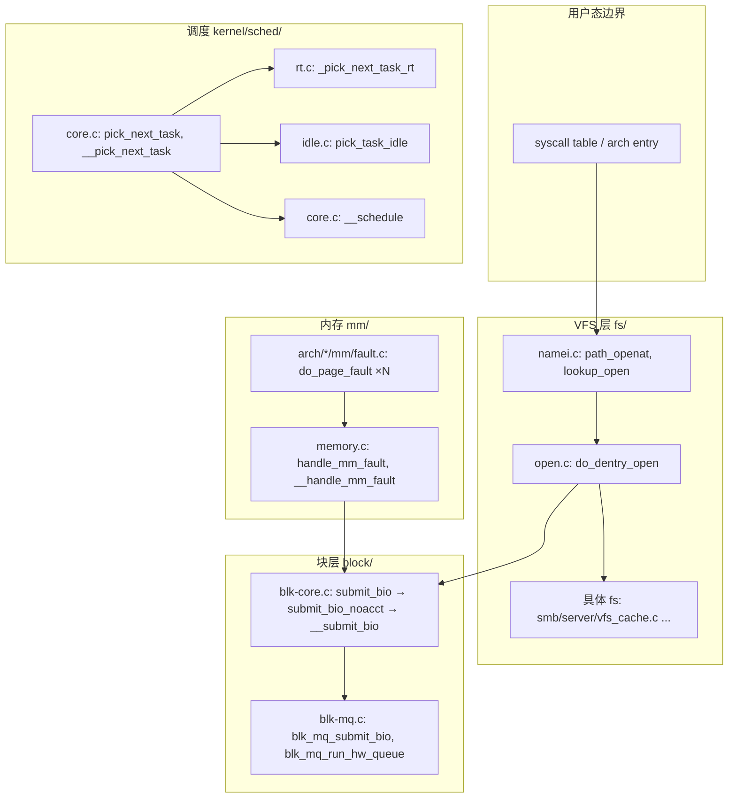

# Code Reading Report: Linux 7.2.12（codesearch 探索）

> 证据分级：`[verified]` = 真实构建/断点/测试实测；`[static]` = 仅静态（含所有 code search 结果）。
> 本报告**全部结论为 `[static]`**，原因见 §1。

## 1. Scope & purpose

- **Purpose（用户原话）**：「你用 codesearch 探索下 linux 内核，遵循 codesearch 最佳实践文档，探索结果内容写入 kernel-7.2.12.md」。
  未给单一功能问题 → 按文档 §1-1 / §4-Phase2 走**默认路径**：整体架构（横向）→ 子模块（纵向），不反问。
- **数据源**：索引 `linux_7212`，源码根 `/opt/linux/src/linux-7.2.12`，分析目录
  `/opt/code_caches/linux_7212_cache`（vector + HNSW + KV 均在位：`search` 单次 ~135 ms，
  `context`/`dataflow` 有返回，索引可用）。
- **命令通道**：文档 §2 的 `ai_code_search.sh` / `cache_query` 不在本仓库；用 lite 的 `codesearch`
  工具（同一 C 后端 `src/codesearch/api.c`），动作映射：
  `search`↔`$ACS search`、`context`/`symbol`↔`$CQ --type`、`dataflow`↔`$ACS dataflow`。
- **Environment：未本地跑通**。7.2.12 完整构建需生成 `.config` + 30min+ 与 root 环境，
  本次不做 → 按文档 §7-7 **降级为「静态阅读」并明说**，Phase 5（断点 backtrace）未执行。
- **Out of scope**：驱动具体实现（`drivers/`）、各架构异常入口细节、构建系统。

## 2. Architecture overview（横向）                    [static]

组件由图谱来自 `search` 命中的 `file:line` 归属 + `context` 的 caller/callee 边，不依赖手工翻目录：



- `[static]` 依据：`fs/namei.c:4872 path_openat`、`fs/namei.c:4433 lookup_open`、`fs/open.c:885 do_dentry_open`、
  `mm/memory.c:6651 handle_mm_fault`、`kernel/sched/core.c:6717 pick_next_task`、`kernel/sched/core.c:7107 __schedule`、
  `block/blk-core.c:952 submit_bio`、`block/blk-mq.c:3108 blk_mq_submit_bio`。
- **主线/支线（机制 B，用 `context` 的 callers 数而非 grep）**：

| 接口 | callers | callees | 判读 |
|---|---|---|---|
| `mm/memory.c:handle_mm_fault` | 30 | 6 | 扇入高，但 30 个里绝大多数是**同名的各架构 `do_page_fault`**；真实上游只有 `faultin_page`/`fixup_user_fault`/`do_user_addr_fault` → 主线，纵读 |
| `fs/open.c:do_dentry_open` | 5 | 10 | 中等扇入，VFS 收敛点 → 纵读 |
| `block/blk-core.c:submit_bio` | 3 | 1 | 扇入**偏低且失真**（见 §6 可疑点） |
| `kernel/sched/core.c:__schedule` | 3 | — | 扇入失真（真实 `schedule()` 未连边） |

## 3. Core data structures & relationships             [static]

`--kind struct` 可用，但排序被词面主导，本次未能拿到核心类型定义（见 §7 Follow-ups）：

| 结构 / 查询 | 命中 | 创建者 | 持有者 | 修改处 | 角色 |
|---|---|---|---|---|---|
| `struct bio`（查询 `bi_bdev` 的 dataflow） | 28 处 / 10 函数 | `bio_init`（bio.c:217 区域）、`bio_reset`（:274） | `submit_bio` 链携带至 `blk_mq_submit_bio` | `bio_endio`(:1827)、`guard_bio_eod`(:718)、`bio_await`(:1567)、trace 点 | 块层 IO 描述符（扇出最小的数据单元） |
| `struct dentry *` / `struct inode *` | `ksmbd_lookup_fd_inode`(vfs_cache.c:1025)、`openpromfs_lookup`(inode.c:181)、`__ksmbd_inode_lookup`(:188) | fs 的 `lookup` 回调 | dcache / 具体 fs 私有表 | 各 fs `dentry_operations` | VFS 路径解析的缓存键 |
| `struct file *` | `do_dentry_open`（fs/open.c:885）产出 | `do_dentry_open`/`finish_open` | `fd` 表 | — | open 之后的一切用户态 IO 的句柄 |
| `struct vm_area_struct *` | `handle_mm_fault`(memory.c:6651) 首参 | `mmap` 家族 | `mm_struct` 红黑树 | — | fault 的地址空间契约 |
| `struct rq *` | `pick_next_task`(core.c:6717)、`_pick_next_task_rt`(rt.c:1701) | — | per-CPU | — | 调度决策的作用域 |

关系（`[static]`，由 callee 边得出）：`bio → (下传) blk_mq_submit_bio → rq | plug`；
`dentry + inode → file`（`do_dentry_open` 的 callees 含 `file_inode`、`open` 回调）；
`vma → pte`（`handle_mm_fault → __handle_mm_fault`、`hugetlb_fault` 两支）。

## 4. Vertical analysis                        [static]（Phase 5 未执行）

### 4.1 open 路径
```
path_openat (fs/namei.c:4872)
  └─ lookup_open (fs/namei.c:4433)          # 名字解析 + dcache 命中/未命中
       └─ do_dentry_open (fs/open.c:885)    # callers: vfs_open / finish_open / build_open_flags / pidfs_dentry_open
            callees: file_get_write_access, break_lease, security_file_open,
                     fsnotify_open_perm_and_set_mode, iocb_flags, file_inode, open(fs 回调)
```
判读：`do_dentry_open` 是 **VFS → 具体 fs 的唯一收紧点**——`open` 是回调指针，所以调用图在此断链
（`paths:` 里出现 `do_dentry_open -> finish_open -> ceph_atomic_open` 等多 fs 分支，说明反向可达但正向不唯一）。

### 4.2 page fault 路径
```
arch/*/mm/fault.c: do_page_fault  (每个架构一份同名实现)
  └─ handle_mm_fault (mm/memory.c:6651)      # sanitize_fault_flags → 分流
       ├─ __handle_mm_fault                  # 匿名/文件页
       └─ hugetlb_fault                      # 大页
```

### 4.3 块 IO 路径
```
submit_bio (block/blk-core.c:952)            # 记 PGPGIN/PGPGOUT + bio_set_ioprio
  └─ submit_bio_noacct (:817)                # REQ_OP_* 合法性闸门
       └─ __submit_bio (:670)
            └─ blk_mq_submit_bio (blk-mq.c:3108)
                 ├─ blk_insert_flush / plug 命中 → blk_add_rq_to_plug 返回
                 └─ RQF_USE_SCHED 或 dispatch_busy → blk_mq_insert_request + blk_mq_run_hw_queue
```

### 4.4 调度路径
```
pick_next_task (kernel/sched/core.c:6717)
  └─ __pick_next_task (:6149)
       ├─ _pick_next_task_rt (sched/rt.c:1701)
       └─ pick_task_idle (sched/idle.c:504)
__schedule (core.c:7107)  ← 切换本体的落点
```

## 5. Black boxes（有意不展开）

| 接口 | 输入 | 输出 | 作用 | 为何不开 |
|---|---|---|---|---|
| `open(struct inode*, struct file*)` 回调 | inode/file | errno | fs 自定义 open | 指针调用，纵深是「每个 fs 一份」，本次只记锚点 |
| `pick_task_*` / sched_class 族 | `rq` | 任务 | 调度类多态 | 调用图在此断链（见 §6） |
| `blk_mq_*` 硬件队列分配 | `bio`/`rq` | 下发 | 多队列映射 | 属驱动边界，超 Scope |
| `security_file_open`（LSM 钩子） | file | errno | 权限 | 命中 `security/smack/smack_lsm.c:2364`，但与主线弱相关 |
| `ksmbd_*`（fs/smb/server/vfs_cache.c） | dentry | inode | SMB 服务侧 cache | 支线，只记接口 |

## 6. Design commentary & open questions

- **为何 `bio` 是块层的公共数据单元而不是 `request`**：`dataflow bi_bdev` 显示 `bio` 的创建（`bio_init`/`bio_reset`）
  与终结（`bio_endio`）在层内高度集中，而 `request` 由 `blk-mq` 在更后面才构造 → 与「bio 表达 IO 语义、rq 表达调度」
  的分层一致 `[static]`。
- **同一抽象在每架构复制**：`do_page_fault` 在 arm/s390/loongarch/openrisc/powerpc/um 等各一份，
  `handle_mm_fault` 的 30 个 callers 里大半是它们。这是内核有意的「arch 边界」而非重复代码，
  但它**污染语义搜索**：查 fault 类问题必须加 `--file arch/` 或反选。
- **若我来设计索引**（对 codesearch 本身）：struct 块与核心类型（`task_struct` 在 `include/linux/sched.h`）
  应参与排序；当前 `--kind struct` 查 `task_struct` 只回 `bpf.h` 匿名 struct、`dsp_task_descriptor`
  （sound/pci/cs46xx）这类词面近邻 → **核心类型定义没进候选**。
- **可疑点（文档 §9 反模式的反面证据）**：调用图扇入在此仓库上偏保守：
  - `path_openat` 的 `context` 只回 `paths: path_openat`（无 caller/callee）；
  - `__schedule` callers 只有 `latency_fsnotify` / `__klp_sched_try_switch` / `tick_nohz_kick_task`；
  - `submit_bio` callers 只有 3（`submit_page_section`、`disk_zone_wplug_submit_bio`、`__submit_bio`），
    而真实上游大量走 `submit_bio_noacct` / `submit_bh`。
  → **扇入只能当相对排序用，不能当绝对事实**；承重结论仍需 `[verified]`。

## 7. Follow-ups

- [ ] **Phase 5 补做 `[verified]`**：`make defconfig && make -j` 后在小内核里断 `handle_mm_fault` / `submit_bio`，
      取 backtrace，再对每帧 `context --depth 2`（机制 A）。这是本报告唯一的大缺口。
- [ ] **Phase 6 用测试当场景**：`search "page fault" --file test`、`tools/testing/selftests/mm/` 下的
      `gup_test`/`hmm-tests` 直接充当 fault 场景入口。
- [ ] **补 `struct` 覆盖**：显式 `search "struct task_struct {"` / `include/linux/sched.h` 定位定义，
      再把 `dataflow state`/`dataflow prio` 做成「谁创建/持有/改」表。
- [ ] **横向补全**：本次只画了 VFS/MM/SCH/BLK 四条线；`net/`（`sk_buff`）、`kernel/printk`、
      中断子系统（`irq_desc`）未探索。
- [ ] 索引侧：`arch/` 同名函数建议在 chunk 元数据里带 `arch=` 维度，供 `--file/--skip` 过滤，减少语义搜索污染。

---

### 附：本次实际执行的 codesearch 调用（可复现）

```
codesearch action=search   project=linux_7212 "system call entry table sys_call_table"
codesearch action=search   "virtual filesystem inode dentry path walk lookup open"
codesearch action=search   "page fault handler handle_mm_fault map pages"
codesearch action=search   "scheduler pick next task run queue context switch"
codesearch action=search   "block layer submit_bio request queue elevator dispatch"
codesearch action=context  handle_mm_fault --depth 2      # callers(30) callees(6) + paths
codesearch action=context  submit_bio      --depth 2      # callers(3)  callees(1)
codesearch action=context  path_openat     --depth 2      # 仅 paths（节点缺失）
codesearch action=context  __schedule      --depth 2
codesearch action=context  do_dentry_open  --depth 2      # 主纵读点
codesearch action=dataflow bi_bdev                        # 28 处 / 10 函数
codesearch action=search   --kind struct "block IO request bio structure device queue"  # 0 hit
codesearch action=search   --kind struct "task_struct process descriptor"               # 只回词面近邻
```
