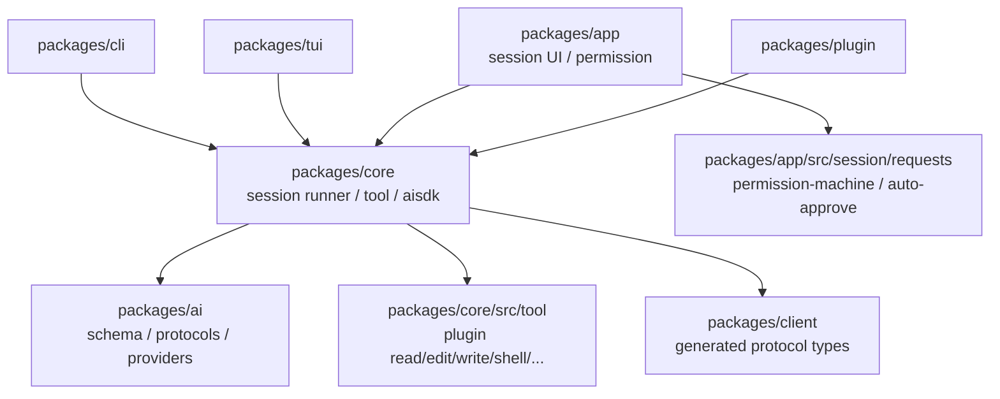
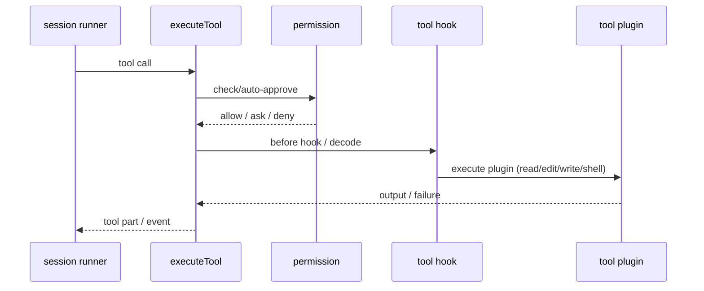

# Code Reading Report: opencode（/opt/opencode）

> 索引：`/opt/code_caches/opencode_cache`（4,706 files / 27,625 chunks，2026-11-09 重建）
> 命名空间：`/code/opencode`
> 方法：`code_search_best_practices.md`；范围：tool 执行/权限、session runner、
> provider stream、TUI/CLI 表面层。
> **所有结论来自 code search 或源码相邻关系，标 `[static]`；未运行 opencode，无 `[verified]`。**

## 1. Scope & purpose

- Purpose：研究 opencode 的「工具行为」实现，作为 lite 工具/审批设计的参考。
- 重点：tool 定义与执行、permission 自动批准/回复、session runner、provider 流式、
  CLI/TUI 两条运行路径。
- 不展开：desktop、web、site、各种 UI story/fixture、生成代码细节。
- 环境限制：未启动 opencode server/TUI；工具审批与流式事件需运行时验证。

## 2. Architecture overview（横向）                    [static]



包职责（目录/包名）：

| 包 | 职责 |
|---|---|
| `packages/core` | session runner、tool runtime、AI SDK 适配、配置/normalize |
| `packages/ai` | 消息/tool schema、provider 协议、流式 |
| `packages/app` | session UI 状态机、permission requests、auto-approve |
| `packages/tui` | 终端 UI 与 `mini` 传输/渲染 |
| `packages/cli` | 非交互/CLI 运行入口 |
| `packages/plugin` | 插件 tool 接口（promise/effect 两套） |
| `packages/client` | 生成的 client/protocol 类型 |
| `packages/session-ui` / `web` / `desktop` | UI/桌面层 |

## 3. Tool 执行                                      [static]

```text
session runner step
  → executeTool（core/session/runner/step.ts）
  → 工具插件（core/src/tool/plugin/{read,edit,write,shell,glob,grep,...}.ts）
  → ToolDefinition / ToolEditor 适配
  → permission 检查（app/session/requests）
  → 输出 tool part / event
```

证据：

- `executeTool`：`packages/core/src/session/runner/step.ts:executeTool`；
  callers `run`、`create`、`check`、`inventoryTools`、`make`；
  callees `output`、`failure`、`hooked`、`decode`。
  说明执行入口本身已经带 hook、decode、失败封装。
- `ToolDefinition`：`packages/ai/src/schema/messages.ts:ToolDefinition`；
  `ToolDefinitionInput`：同文件 `:389`。
- `ToolEditor`：
  - `packages/plugin/src/promise/tool.ts:ToolEditor`
  - `packages/plugin/src/effect/tool.ts:ToolEditor`
- 内建工具按插件拆分：`packages/core/src/tool/plugin/`
  - `read.ts`、`edit.ts`、`write.ts`、`shell.ts`、`glob.ts`、`grep.ts`、
    `patch.ts`、`webfetch.ts`、`websearch.ts`、`subagent.ts`、`skill.ts`、
    `todo.ts`、`question.ts`、`mcp-resource.ts`、`image-generate.ts`。
  - `packages/core/src/tool/runtime.ts`、`read-filesystem.ts` 提供 runtime 支撑。
- `executeTool` 的 `hooked`/`decode` 说明工具执行不是裸函数调用，而是带
  before/after hook 与输出解码的流水线。

## 4. Permission / approval                          [static]

```text
PermissionDecision
  → createPermissionAutoApprover
  → approve / covers / sweep
  → replyPermission（CLI/TUI）
```

- `PermissionDecision`：`packages/app/src/session/requests/permission-machine.ts:5`。
- `createPermissionAutoApprover`：
  `packages/app/src/session/requests/auto-approve.ts:createPermissionAutoApprover`；
  同文件 `approve`（`:265`）。
  callees 包括 `executeSweep`、`dispatchSweep`、`consider`、`transitionAutoApprove`、
  `approve`、`covers`、`reply` 等，说明 auto-approve 是状态机 + sweep 模型。
- `PermissionReplyOutput` / `PermissionReplyInput` / `PermissionReply`：
  `packages/client/src/promise/generated/types.ts`。
- CLI：`replyPermission`（`packages/cli/src/run/noninteractive.ts:97`）。
- TUI mini：`permissionTool`（`packages/tui/src/mini/stream-v2.transport.ts:332`）、
  `askPermission` / `emitPermission`（`packages/tui/src/mini/demo.ts`）、
  `permissionReply`（`packages/tui/src/mini/permission.shared.ts:79`）。
- 结论：权限有两层——app 层 auto-approve 状态机 + CLI/TUI 的显式回复；
  工具执行前由 session runner 触发。

## 5. Session / prompt turn                           [static]

- `PromptRequest`：`packages/core/src/session/session.ts:33`。
- `SessionPromptOutput`：`packages/client/src/promise/generated/types.ts:3418`。
- `runNonInteractivePrompt`：`packages/cli/src/run/noninteractive.ts:66`；
  callers `execute`；callees `TerminalClient::subscribe`、`replyPermission`、
  `lifecycle`、`consume`、`cancelForm`、`projectedMessages` 等。
  这是 CLI 非交互路径：订阅事件、处理 permission 回复、消费流。
- TUI 路径：
  - `runPromptTurn`：`packages/tui/src/mini/stream-v2.transport.ts:1833`（TUI mini 传输）
  - `runShellTurn`：`:1579`
  - `admitPromptTurn`：`:1812`
  - `runNonInteractivePrompt` 与 `runPromptTurn` 是两条表面层路径，
    核心执行仍落到 `packages/core` 的 session runner/tool runtime。
- 注意：`tui/src/mini` 是 TUI 的轻量传输/演示层，不能当作唯一生产路径；
  报告把它标为 surface 层证据。

## 6. Provider / stream                               [static]

```text
modelFromLanguage
  → streamLanguage（packages/core/src/aisdk.ts）
  → streamPartEvents / doStream
  → provider protocol（packages/ai/src/protocols/*）
```

- `streamLanguage`：`packages/core/src/aisdk.ts:streamLanguage`；
  caller `modelFromLanguage`；callees `streamPartEvents`、`doStream`、
  `TerminalService::pipe`、`stepStart`、`llmError`。
- `modelFromLanguage`：`packages/core/src/aisdk.ts:modelFromLanguage`；
  callees `streamLanguage`、`callOptions`、`mapBodyToProviderOptions`、
  `providerOptionKey`、`invalidRequest` 等。
- `LanguageModelInput`：`packages/ai/src/schema/options.ts:379`。
- `packages/ai/src/providers/openai-compatible.ts` 等按协议拆分 provider；
  `packages/ai/src/route/executor.ts:stream` 是另一条流式执行路径。

## 7. Core data structures                            [static]

| 结构 | 定义 | 角色 |
|---|---|---|
| `ToolDefinition` | `packages/ai/src/schema/messages.ts:391` | 模型侧 tool 描述 |
| `ToolDefinitionInput` | 同文件 `:389` | tool 输入定义 |
| `ToolEditor` | `packages/plugin/src/promise/tool.ts:26` / `effect/tool.ts:8` | 插件工具编辑接口 |
| `PermissionDecision` | `packages/app/src/session/requests/permission-machine.ts:5` | 权限决策 |
| `PromptRequest` | `packages/core/src/session/session.ts:33` | 一次 prompt 请求 |
| `SessionPromptOutput` | `packages/client/src/promise/generated/types.ts:3418` | 会话输出协议 |
| `LanguageModelInput` | `packages/ai/src/schema/options.ts:379` | provider 模型输入 |

## 8. 纵向：一次 tool 调用                            [static]



- `executeTool` 的 callees `hooked`/`decode` 表明 hook 与输出解码在工具执行内层。
- permission 在 app 层状态机/CLI/TUI 之间往返；工具本身不直接弹审批。
- `ToolEditor`（plugin 两套接口）负责把插件工具适配到 agent/tool schema。

## 9. Black boxes（有意不展开）

| 目录 | 作用 | 为何不展开 |
|---|---|---|
| `packages/desktop`、`packages/web`、`services/site` | UI/网站 | 展示层 |
| `packages/session-ui`、`stories`、fixtures | UI 组件/故事 | 非执行核心 |
| `packages/client` 生成类型 | 协议类型 | 生成代码，只引用 |
| `packages/plugin` 全部实现 | 插件运行时 | 只展开 ToolEditor 接口 |
| `packages/codemode` | 沙箱执行 | 独立执行模型 |
| `packages/httpapi-codegen` / `http-recorder` | 协议生成/录制 | 工具链 |

## 10. Design commentary & open questions

- **tool 是插件目录而不是大 switch**：`packages/core/src/tool/plugin/*.ts`
  每个工具一个文件，通过 `ToolDefinition`/`ToolEditor` 适配，便于新增工具。
  `[static]`
- **审批与工具解耦**：工具执行只调用 `executeTool`，权限由 app 层
  permission-machine/auto-approve 与 CLI/TUI 回复共同决定。`[static]`
- **CLI/TUI 两条 surface**：非交互路径直接订阅 terminal client；TUI 走 mini
  transport。核心 session runner 在 `packages/core`，不要把 mini 当唯一实现。
  `[static]`
- 可疑点：`packages/tui/src/mini` 下同时有 tool/permission/session 的大文件
  （`stream-v2.transport.ts`、`tool.ts`），演示/生产边界不够清晰；
  需要运行时确认 TUI 是否复用 core runner。
- 若我来设计：把 mini 传输层与核心 session runner 的边界写死为接口，
  避免 UI 层复制 tool/permission 逻辑。

## 11. Follow-ups

- [ ] 启动 opencode server，实际跑一次 read/edit/shell，观察 `executeTool`
      的 hook/approval 顺序 `[verified]`。
- [ ] 确认 TUI mini 与 core runner 是否共用同一 `ToolDefinition`。
- [ ] 跟踪 `createPermissionAutoApprover` 的 sweep 状态机，核对 deny 原因。
- [ ] 对比 Pi/Reasonix 的 tool 适配与 permission 抽象。
- [ ] 检查 LSP diagnostics 是否进入工具结果（`runLsp`/`snapEdit` 目前只在
      tui mini 路径看到）。

## 12. 证据索引

- tool：`packages/core/src/session/runner/step.ts:executeTool`、
  `packages/core/src/tool/plugin/*`
- schema：`packages/ai/src/schema/messages.ts:ToolDefinition`
- permission：`packages/app/src/session/requests/auto-approve.ts:createPermissionAutoApprover`、
  `permission-machine.ts:PermissionDecision`
- session：`packages/core/src/session/session.ts:PromptRequest`、
  `packages/cli/src/run/noninteractive.ts:runNonInteractivePrompt`
- provider：`packages/core/src/aisdk.ts:streamLanguage`、`modelFromLanguage`
