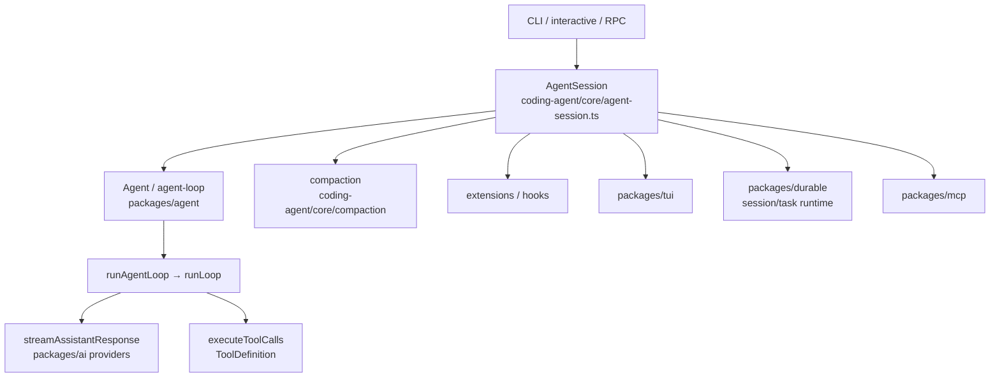
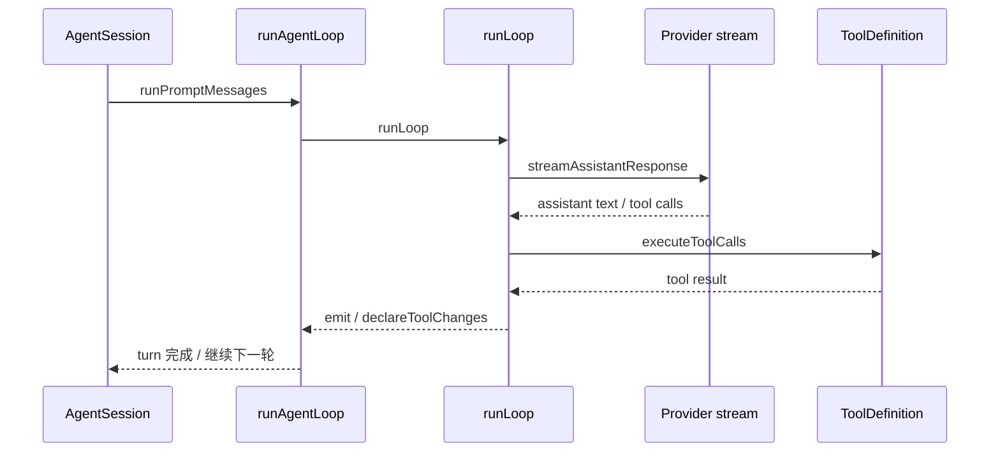

# Code Reading Report: Pi（/opt/pi-mono）

> 索引：`/opt/code_caches/pi-mono_cache`（1,441 files / 17,816 chunks，2026-11-09 重建）
> 命名空间：`/code/pi-mono`
> 方法：`code_search_best_practices.md`；范围：agent 骨架 / 会话与 compaction /
> 工具定义与执行 / provider / TUI / 扩展。
> **所有结论来自 code search 或源码相邻关系，标 `[static]`；未运行 Pi，无 `[verified]`。**

## 1. Scope & purpose

- Purpose：研究 Pi 的「最小 agent harness」骨架，作为 lite 的参考。
- 重点：agent loop、tool definition/执行、session/compaction、provider 抽象、TUI、扩展钩子。
- 不展开：`apps/p2`、`chord` 对象运行时、`codemode` 沙箱、`env` 远程执行、MCP 协议细节。
- 环境限制：本机未安装/运行 Pi；结论需后续用 `npm test`、真实 CLI/RPC 运行验证。

## 2. Architecture overview（横向）                    [static]



包职责（`packages/*/package.json` 描述）：

| 包 | 职责 |
|---|---|
| `agent` | 通用 agent loop、transport 抽象、状态管理 |
| `coding-agent` | CLI、read/bash/edit/write 工具、session、compaction、扩展 |
| `ai` | 统一 LLM API、provider 配置与模型发现 |
| `durable` | 持久化会话/任务/文档运行时 |
| `tui` | 差分渲染的终端 UI 库 |
| `mcp` | 独立 MCP client |
| `codemode` | 只允许调用注入工具的 JS 沙箱 |
| `env` | SSH 远程执行环境 |
| `schema` / `telemetry` / `chord` | JSON Schema、遥测契约、对象运行时 |

## 3. Agent loop 与工具执行                            [static]

主循环（`packages/agent`）：

- `runAgentLoop`（`agent-loop.ts:runAgentLoop`）：callers `agentLoop`、`runPromptMessages`、
  `agentLoopContinue`；callees `getDefaultStreamFn`、`runLoop`、`emit`、`declareToolChanges`。
- `runLoop`（`agent-loop.ts:runLoop`）：callees `streamAssistantResponse`、
  `executeToolCalls`、`failToolCallsFromTruncatedMessage`、`emit`、`declareToolChanges`。
- `agentLoop` / `agentLoopContinue` / `runPromptMessages` 是不同入口：
  `runPromptMessages` 在 `agent/src/agent.ts`，由 `Agent` 类使用。
- `Agent` 类：`agent/src/agent.ts:Agent`（运行状态 + transport + 附件）；
  `AgentSession` 类：`coding-agent/src/core/agent-session.ts:AgentSession`（CLI 层会话）。

工具定义链路：

```text
tool 实现
  → createToolDefinition / createAgentTool
  → wrapToolDefinition（tool-definition-wrapper.ts）
  → ToolDefinition（extensions/types.ts）
  → executeToolCalls → 工具 execute()
```

证据：

- `ToolDefinition`：`coding-agent/src/core/extensions/types.ts:ToolDefinition`。
- `ToolDef` / `createToolDefinition`：`coding-agent/src/core/tools/index.ts`。
- `wrapToolDefinition`、`createToolDefinitionFromAgentTool`：
  `coding-agent/src/core/tools/tool-definition-wrapper.ts`。
- 具体工具：
  - read：`createReadTool` / `createReadToolDefinition` /
    `ReadOperations`（`coding-agent/src/core/tools/read.ts`）。
  - bash：`createBashTool` / `createShellToolDefinition` /
    `BashOperations` / `BashToolDetails`（`core/tools/bash.ts`）；
    `executeBashWithOperations`（`core/bash-executor.ts`）。
  - edit：`createEditToolDefinition`、`computeEditsDiff` /
    `EditDiffResult`（`core/tools/edit.ts`、`edit-diff.ts`）。
  - write：`createWriteTool` / `createWriteToolDefinition` /
    `WriteOperations`（`core/tools/write.ts`）。
- 工具事件：`ToolExecutionStartEvent`、`ToolExecutionUpdateEvent`、
  `ExecuteToolOptions`（`extensions/types.ts`），扩展可观察/拦截工具执行。

## 4. 会话、compaction、扩展                          [static]

- 会话：`AgentSession`（`core/agent-session.ts`）组合 `Agent`、工具注册、session manager、
  extension bindings。
- 扩展钩子：
  - `_installAgentToolHooks`（`agent-session.ts:672`）
  - `_bindExtensionCore` / `_applyExtensionBindings`（`:3482` / `:3458`）
  - `hasExtensionHandlers`（`:4522`）
  - `ExtensionShortcut`、`ExtensionContextActions`（`extensions/types.ts`）
- compaction：
  - `SessionBeforeCompactEvent` / `SessionCompactEvent` /
    `SessionBeforeCompactResult`（`extensions/types.ts`）
  - `CompactionSummaryMessage`（`core/messages.ts:62`）
  - `CompactionPolicy`（`durable/src/harness/types.ts:573`）
  - 事件语义（从命名与类型可见）：压缩前发 before 事件，扩展可改写；
    生成 summary message 后发 compact 事件，替换上下文。

## 5. Provider / 模型                                [static]

```text
builtinProviders
  → openaiProvider / openaiCodexProvider / moonshotaiProvider / xaiProvider ...
  → createProvider
  → streamSimple / provider-specific stream
```

- `openaiProvider`（`ai/src/providers/openai.ts:openaiProvider`）：
  caller `builtinProviders`；callees `openAIDecisionsApi`、`openAIResponsesApi`、
  `lazyOAuth`、`envApiKeyAuth`、`createProvider`。
- `streamSimple`（`ai/src/api/bedrock-converse-stream.ts`）是 provider 流式入口之一。
- provider 文件按厂商拆分：`ai/src/providers/*.ts`，由 `builtinProviders` 汇总。

## 6. TUI 与 UI 事件                                  [static]

- `createInteractiveTui`（`coding-agent/src/modes/interactive/tui-renderer.ts`）
- `switchTuiMode`（`modes/interactive/interactive-mode.ts:921`）
- `beforeTerminalStop`（`packages/tui/src/tui-alt-screen.ts:389`）
- TUI 是独立库（`packages/tui`），coding-agent 只做 renderer 适配；
  `apps/p2` 还有自己的 TUI 组件，不作为主骨架。

## 7. Core data structures                            [static]

| 结构 | 定义 | 角色 |
|---|---|---|
| `Agent` | `packages/agent/src/agent.ts:Agent` | 运行中的 agent，持有 transport/state |
| `AgentSession` | `coding-agent/src/core/agent-session.ts:AgentSession` | CLI 会话，组合工具/扩展/session |
| `ToolDefinition` | `coding-agent/src/core/extensions/types.ts:ToolDefinition` | 统一工具描述与 execute 接口 |
| `ToolDef` | `coding-agent/src/core/tools/index.ts:ToolDef` | 工具实现/注册类型 |
| `CompactionPolicy` | `durable/src/harness/types.ts:CompactionPolicy` | 压缩阈值/保留策略 |
| `CompactionSummaryMessage` | `coding-agent/src/core/messages.ts:CompactionSummaryMessage` | 压缩后 summary 消息 |
| `SessionCompactEvent` | `coding-agent/src/core/extensions/types.ts:SessionCompactEvent` | 压缩完成事件 |
| `ReadOperations` / `BashOperations` / `WriteOperations` | 各工具文件 | 工具依赖注入接口 |

## 8. 纵向：一轮 prompt 与工具调用                      [static]



说明：

- `runAgentLoop` 负责初始化 turn、调用 `runLoop`，并把 stream/tool 事件 emit 出去。
- `runLoop` 是实际循环：流式 assistant 回复、执行工具、处理截断消息中的工具调用，
  直到没有新的 tool call。
- 工具执行由 `ToolDefinition` 抽象；read/bash/edit/write 都是 `createXxxTool`
  返回定义，再由 wrapper 适配到 agent tool。

## 9. Black boxes（有意不展开）

| 接口/目录 | 作用 | 为何不展开 |
|---|---|---|
| `apps/p2` | 基于 Pi SDK 的应用/插件 | 应用层，不是 harness 骨架 |
| `packages/chord` | 跨进程对象运行时 | 与 agent loop 解耦 |
| `packages/codemode` | JS 沙箱 + 注入工具 | 独立执行模型 |
| `packages/env` | SSH 远程执行 daemon | 部署/环境层 |
| `packages/mcp` | MCP client | 协议实现 |
| `packages/schema` / `telemetry` | JSON Schema / 遥测 | 基础设施 |

## 10. Design commentary & open questions

- **分层清楚**：agent core（`packages/agent`）不依赖 coding-agent；coding-agent 通过
  `AgentSession` 组合工具、session、扩展和 TUI。`[static]`
- **工具适配层**：`ToolDefinition` + `wrapToolDefinition` 把「工具实现」与
  「agent 可调用定义」解耦，便于扩展/插件注入。`[static]`
- **compaction 走事件**：before/after compact 事件允许扩展改写摘要，说明会话压缩不是
  硬编码流程。`[static]`
- **provider 按厂商拆文件**：`builtinProviders` 是统一注册点，新增厂商只需加 provider。
  `[static]`
- 可疑点：扩展钩子直接在 `AgentSession` 上绑定（`_bindExtensionCore` 等），
  session 类会很大；是否会把工具/permission 逻辑也卷进 session，需要运行时验证。
- 若我来设计：把 extension hook 的注册/派发再抽出一层，避免 `AgentSession` 继续膨胀。

## 11. Follow-ups

- [ ] 实际运行 `runAgentLoop` 的单元测试/CLI，补 `[verified]` 的 tool/stream 时序。
- [ ] 用 gdb/Node inspector 在 `executeToolCalls` 与 `streamAssistantResponse` 下断点。
- [ ] 展开 `compaction` 实现，确认 summary 如何替换上下文。
- [ ] 检查 `AgentSession` 与 extension 的权限边界（工具白名单/审批）。
- [ ] 对比 opencode 的 tool 执行与 permission，提炼共同抽象。

## 12. 证据索引

- agent loop：`packages/agent/src/agent-loop.ts:runAgentLoop`、`runLoop`、`agentLoop`
- agent：`packages/agent/src/agent.ts:Agent`
- session：`packages/coding-agent/src/core/agent-session.ts:AgentSession`
- tools：`core/tools/{read,bash,edit,write}.ts`、`tool-definition-wrapper.ts`
- compaction：`core/messages.ts:CompactionSummaryMessage`、`extensions/types.ts:SessionCompactEvent`
- provider：`packages/ai/src/providers/openai.ts:openaiProvider`
- TUI：`modes/interactive/tui-renderer.ts:createInteractiveTui`
