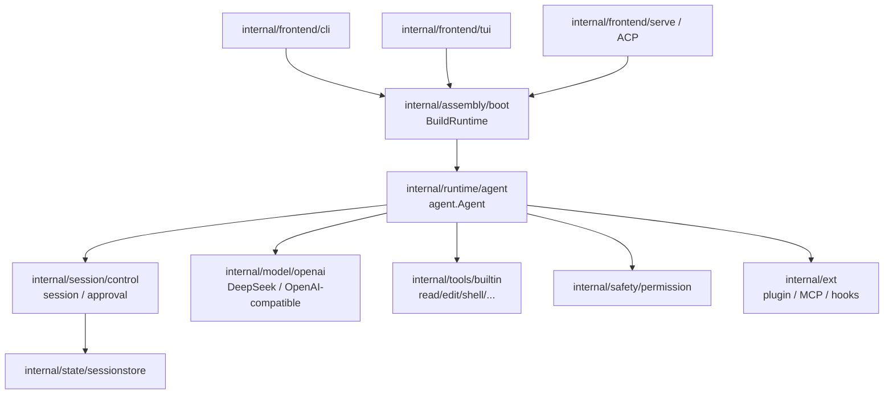
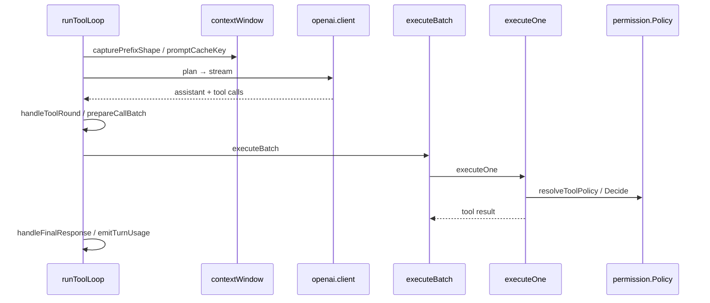

# Code Reading Report: Reasonix（/opt/reasonix）

> 索引：`/opt/code_caches/reasonix_cache`（7,152 files / 61,933 chunks，2026-11-09 重建）
> 命名空间：`/code/reasonix`
> 方法：`code_search_best_practices.md`；范围：agent runtime / DeepSeek provider /
> prompt cache / tool loop / permission / session compaction。
> **所有结论来自 code search 或源码相邻关系，标 `[static]`；未运行 Reasonix，无 `[verified]`。**

## 1. Scope & purpose

- Purpose：研究 Reasonix 的「DeepSeek 原生 + 缓存优先」实现，作为 lite 的参考。
- 重点：DeepSeek/OpenAI-compatible provider、prompt cache key 与 prefix shape、
  agent tool loop、tool permission gate、session compaction。
- 不展开：desktop/Electron、frontend-next、Cloudflare workers、SDK、Android、benchmark。
- 环境限制：未构建/运行 Go 服务；权限、缓存命中、工具审批均需运行时/日志验证。

## 2. Architecture overview（横向）                    [static]



Go 目录职责（从 `go.mod`/目录结构）：

| 目录 | 职责 |
|---|---|
| `cmd/reasonix`、`cmd/reasonix-studio-host` | CLI / Studio host 入口 |
| `internal/assembly/boot` | 组装 runtime、扩展 sidecar、预检 |
| `internal/runtime/agent` | agent loop、上下文窗口、cache shape、工具执行 |
| `internal/session/control` | session controller、审批、history、turn orchestration |
| `internal/model/openai` | DeepSeek/OpenAI-compatible provider 与流式解析 |
| `internal/model/{anthropic,gemini,...}` | 其他 provider |
| `internal/safety/permission` | 工具权限策略与 gate |
| `internal/tools/builtin` | read/edit/write/shell 等内建工具 |
| `internal/ext` | 插件、MCP、hooks、扩展协议 |
| `internal/state/sessionstore` | 会话持久化 |
| `internal/frontend/{cli,tui,serve,api,acp}` | 前端表面层 |

## 3. DeepSeek / provider                             [static]

```text
openai::New
  → openai::deepSeekPrefixChatURL（DeepSeek host 识别/URL）
  → openai.client::Stream
  → openStream → readStream
```

- `openai::deepSeekPrefixChatURL`：`internal/model/openai/host.go:34`；
  caller `openai::New`；callees `openai::IsDeepSeek`、`Parse`。
  说明 DeepSeek 走 OpenAI-compatible 通道，通过 host/前缀识别。
- `openai.client::Stream`：`internal/model/openai/openai.go:418`；
  `openStream`：`:432`；`readStream`：`:779`。
- provider 目录还有 `anthropic`、`gemini`、`responses` 等；DeepSeek 不是单独协议栈，
  而是 OpenAI-compatible 的一等 provider。
- `providerbroker::streamRequest` 与 `internal/model/providerbroker` 负责 provider
  选择/健康/连接复用（从目录与搜索命中可见，未展开）。

## 4. Prompt cache 优先                               [static]

核心符号：

- `agent::promptCacheKey`：`internal/runtime/agent/preflight.go:463`
- `agent.contextWindow::currentPromptCacheKey`：`preflight.go:121`
- `agent.contextWindow::currentPromptCacheKeyLocked`：`preflight.go:130`
- `agent.Agent::capturePrefixShape`：`internal/runtime/agent/agent.go:1387`
- `agent::CaptureShape`：`internal/runtime/agent/cache_shape.go:38`
- `agent::CompareShape`：`cache_shape.go:118`
- `agent.contextWindow::requestCalibrationShape`：`output_budget.go:139`

从符号关系可读出的设计：

1. 每次请求在 preflight 阶段生成/读取 **prompt cache key**。
2. 同时捕获 prefix shape（消息/工具/系统前缀的形状），用 `CompareShape` 判断
   前缀是否可复用。
3. tool loop 在调用 provider 前会 `capturePrefixShape`，调用后 `emitTurnUsage` /
   `observeRunBudget`，把 cache hit / token 用量纳入预算与 telemetry。
4. `runToolLoop` 的 callees 中同时出现 `capturePrefixShape`、`CompareShape`、
   `settleRewritesBeforeSampling`，说明缓存判定发生在实际 sampling 之前，
   避免“先改前缀再请求”导致缓存失效。

这对应「缓存优先」的核心：**先稳定前缀（shape/key），再 sampling**。

## 5. Agent tool loop                                  [static]



证据：

- `agent.Agent::runToolLoop`：`internal/runtime/agent/run_loop.go:195`。
  callees 包括 `capturePrefixShape`、`tool.Registry::ProviderSchemas`、
  `streamWithSamplingRecovery`、`plan`、`settleRewritesBeforeSampling`、
  `observeRunBudget`、`emitTurnUsage`、`handleToolRound`、`prepareCallBatch`、
  `handleFinalResponse`、`withAgentContext` 等。
- `agent.Agent::executeBatch`：`execute_batch.go:157`；
  `agent.Agent::executeOne`：`execute_one.go:107`。
- `executeOne` 的 callees：`interceptToolBefore`、`parseToolCall`、
  `prepareToolExecution`、`resolveToolPolicy`、`finishToolExecution`、
  `recordWorkspaceMutation`、`refuseNetworkToolPaths`、`tool::IsDecisionBarrier`。
- `agent.Agent` 结构：`internal/runtime/agent/agent.go:270`。
- 内建工具：
  - `builtin::editFile`：`internal/tools/builtin/editfile.go:18`；
    `editFile::Execute`：`:45`；`editFile::Preview`：`preview.go:54`。
  - `builtin::multiEdit::Preview`：`preview.go:97`；`builtin::editSource`：
    `editsource.go:14`。
  - 其他工具在 `internal/tools/builtin/`（read/shell/write/...，未逐个展开）。

## 6. Tool permission / approval                      [static]

- `permission.Policy::Decide`：`internal/safety/permission/permission.go:148`；
  `ExplicitlyDenies`：`:155`；`permission.Gate::approve`：`:610`。
- `agent.Agent::applyRecoveryAndPermission`：`execute_one.go:463`。
- `control.denyPermissionApprover::ApproveWithPolicyReason`：
  `internal/session/control/approval_bridge.go:103`。
- `control::approvalManager`：`approval.go:27`；`control::pendingApproval`：
  `controller.go:220`；`event::Approval`：`contract/event/event.go:359`。
- 语义：工具执行前 `resolveToolPolicy` 计算策略/权限；需要审批时进入
  `approvalManager`/`pendingApproval`，由前端（CLI/TUI/serve）回复；
  gate 拒绝时带具体 reason，测试覆盖了大量拒绝/取消/checkpoint 场景。

## 7. Session / compaction                            [static]

- `control.SessionHistory::Compact`：`internal/session/control/port.go:182`（methodSpec）。
- `agent.contextWindow::runCompactionSummary`：
  `internal/runtime/agent/compact_projection.go:689`。
- `agent.contextWindow::summaryProjectionState`：`compact_commit.go:67`。
- `control::contextSummaryLine`：`context_command.go:107`。
- session controller：
  - `control.Controller::SessionPersistedState`：`session_snapshot.go:486`
  - `control.Controller::SessionAuthorizations`：`controller.go:1158`
  - `control.Controller::SessionCache`：`controller.go:1012`
  - `control.Controller::SessionPath`：`session_lifecycle.go:441`
- session 持久化在 `internal/state/sessionstore`；compaction 不是简单截断，
  而是生成 summary projection 并提交（`summaryProjectionState`）。

## 8. Core data structures                            [static]

| 结构 | 定义 | 角色 |
|---|---|---|
| `agent::Agent` | `internal/runtime/agent/agent.go:270` | agent 运行态，持有 contextWindow/tools/provider |
| `agent.contextWindow` | 方法见 `preflight.go` / `compact_*` | 上下文窗口、cache key/shape、压缩投影 |
| `permission.Policy` | `internal/safety/permission/permission.go` | 工具权限策略 |
| `control::approvalManager` | `internal/session/control/approval.go:27` | 审批请求/回复 |
| `control::pendingApproval` | `internal/session/control/controller.go:220` | 待审批状态 |
| `builtin::editFile` | `internal/tools/builtin/editfile.go:18` | edit 工具实现 |
| `openai.client` | `internal/model/openai/openai.go` | DeepSeek/OpenAI-compatible 流式 client |
| `event::Approval` | `internal/contract/event/event.go:359` | 审批事件契约 |

## 9. Black boxes（有意不展开）

| 目录 | 作用 | 为何不展开 |
|---|---|---|
| `desktop/`、`desktop/frontend-next` | Electron/React Studio | UI 层 |
| `workers/` | Cloudflare workers（forum/accounts/crash-report） | 服务端 |
| `android/` | Android 客户端 | 平台层 |
| `sdk/`、`integrations/` | 外部 SDK/插件集成 | 对外接口 |
| `benchmarks/`、`cmd/e2ebench` | 评测 | 非主线 |
| `internal/ext/{mcp,plugin,...}` | 扩展/MCP | 只作为工具/审批来源 |

## 10. Design commentary & open questions

- **缓存优先是显式流程**：prefix shape/key 在 sampling 之前结算，避免前缀漂移；
  这比“请求完再看 cache token”更主动。`[static]`
- **DeepSeek 走 OpenAI-compatible**：`deepSeekPrefixChatURL` + `IsDeepSeek` 做 host
  识别，减少独立协议实现。`[static]`
- **权限是执行前的硬门**：`resolveToolPolicy`/`Policy::Decide`/approval manager
  串成一条链，测试覆盖大量取消/checkpoint 场景。`[static]`
- **session/controller 体积大**：`controller.go` 聚合 session、approval、cache 等
  多个职责；后续可考虑按领域拆分。
- 可疑点：`runToolLoop` 的 callees 非常多（30+），说明单函数承担了 sampling、
  cache、budget、steering、tool round 等多种职责；阅读和测试成本高。
- 若我来设计：把 prefix shape/cache 结算、sampling recovery、tool round 分成
  显式阶段对象，降低 `runToolLoop` 的分支复杂度。

## 11. Follow-ups

- [ ] 实跑一个 DeepSeek 请求，观察 `promptCacheKey` / `CompareShape` / usage cache
      token 是否符合预期 `[verified]`。
- [ ] 断点 `executeOne`，确认 permission/approval 的真实路径。
- [ ] 验证 `runCompactionSummary` 替换上下文后 cache prefix 是否保持稳定。
- [ ] 检查 `internal/ext` 插件是否也走同一 permission/tool registry。
- [ ] 与 opencode/Pi 对比 tool approval 抽象。

## 12. 证据索引

- provider：`internal/model/openai/host.go:deepSeekPrefixChatURL`、
  `openai.go:Stream`
- cache：`internal/runtime/agent/preflight.go:promptCacheKey`、
  `cache_shape.go:CaptureShape/CompareShape`
- loop：`run_loop.go:runToolLoop`、`execute_batch.go:executeBatch`、
  `execute_one.go:executeOne`
- permission：`internal/safety/permission/permission.go:Decide`
- tools：`internal/tools/builtin/editfile.go:editFile`
- compaction：`compact_projection.go:runCompactionSummary`、
  `compact_commit.go:summaryProjectionState`
